Laporan dibuat oleh:
```
Nama: Christina Tan
NRP: 5025241060
```

ETS PBKK - Membuat aplikasi WPF dengan Rich UI
```
Kelompok:
1. Christina Tan (5025241060)
2. Umi Lailatul Khotimah (5025241062)

Topik: Sistem Manajemen Jadwal dan Aktivitas Mahasiswa
```

Dokumen PRD dapat dilihat pada link berikut: [PRD CampusFlow.pdf](./PRD%20CampusFlow.pdf)

<br>

## Ringkasan Aplikasi

CampusFlow merupakan aplikasi desktop berbasis WPF yang membantu mahasiswa mencatat dan mengelola
jadwal kuliah,  tugas & deadline, kegiatan nonkuliah, serta melihat semuanya dalam kalender dan  ringkasan dashboard.

<br>

## Arsitektur Aplikasi

Arsitektur CampusFlow memakai pola **MVVM** dengan 4 lapisan:
```
┌──────────────────────────────────────────────────────────┐
│  View (XAML)        — tampilan, tanpa logika bisnis       │
│      ↕ data binding (Binding, Command)                    │
│  ViewModel          — state UI + command + validasi       │
│      ↕ memanggil method async                             │
│  Repository (Data)  — query SQL                           │
│      ↕ ADO.NET (Microsoft.Data.SqlClient)                 │
│  SQL Server         — database CampusFlow_DB              │
└──────────────────────────────────────────────────────────┘
        ↑ Model (POCO) dipakai lintas lapisan
```
<br>

## Fitur pada CampusFlow:

| Fitur | Deskripsi | Kebutuhan PRD |
|---|---|---|
| Dashboard | Ringkasan jumlah mata kuliah, jadwal hari ini, tugas mendatang, kegiatan, progress bar progres tugas, jadwal hari ini, tugas terdekat, kegiatan mendatang | FR-01 |
| Jadwal Kuliah | CRUD jadwal: mata kuliah, hari, waktu mulai/selesai, ruang. Pencarian & filter hari | FR-02 |
| Tugas & Deadline | CRUD tugas dengan mata kuliah, deskripsi, deadline, prioritas, status. Pencarian & filter prioritas/status | FR-03, FR-06, FR-07 |
| Kegiatan | CRUD aktivitas nonkuliah (organisasi, belajar mandiri, pribadi) dengan tanggal, waktu, lokasi, catatan | FR-04 |
| Kalender | Tampilan mingguan dan harian, dengan warna kategori Jadwal/Tugas/Kegiatan dan penanda hari ini | FR-05 |
| Pengaturan | Info aplikasi, info koneksi database, dan Uji Koneksi ke database | — |

<br>

## Schema Database

Database yang digunakan adalah `CampusFlow_DB` pada SQL Server. Seluruh tabel, relasi, dan data contoh dibuat lewat satu script, yaitu `Database/CampusFlow.sql`.

Terdapat empat tabel utama:

| Tabel | Kolom | Keterangan |
|---|---|---|
| MataKuliah | MataKuliahId, Kode, Nama, SKS | Data master mata kuliah |
| JadwalKuliah | JadwalId, MataKuliahId, Hari, WaktuMulai, WaktuSelesai, Ruang | Jadwal pertemuan kuliah |
| Tugas | TugasId, MataKuliahId, Judul, Deskripsi, Deadline, Prioritas, Status | Tugas beserta prioritas dan status |
| Kegiatan | KegiatanId, Judul, Kategori, Tanggal, WaktuMulai, WaktuSelesai, Lokasi, Catatan | Aktivitas nonkuliah |

Relasi dan aturan yang diterapkan:

- `JadwalKuliah` dan `Tugas` memiliki foreign key ke `MataKuliah`, sedangkan `Kegiatan` tidak terikat mata kuliah.
- `MataKuliahId` pada `Tugas` boleh kosong (NULL), sehingga tugas tetap bisa dicatat tanpa mata kuliah.
- Setiap tabel memakai primary key dengan `IDENTITY` sebagai auto-increment.
- Ada CHECK constraint `WaktuSelesai > WaktuMulai` pada `JadwalKuliah` dan `Kegiatan`, serta pembatasan nilai pada kolom `Prioritas` (Rendah/Sedang/Tinggi) dan `Status` (Belum Dikerjakan/Dalam Proses/Selesai) di tabel `Tugas`.

<br>

## Demo Aplikasi

1. Tampilan dashboard awal

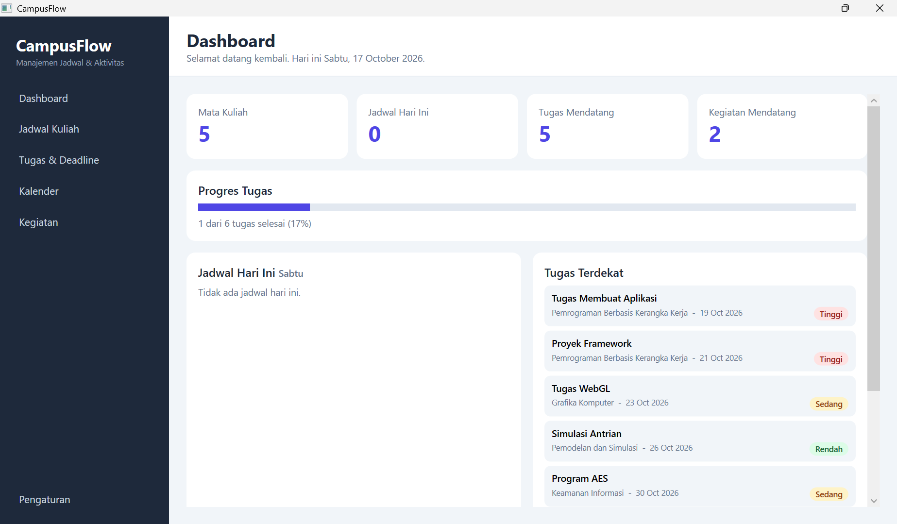

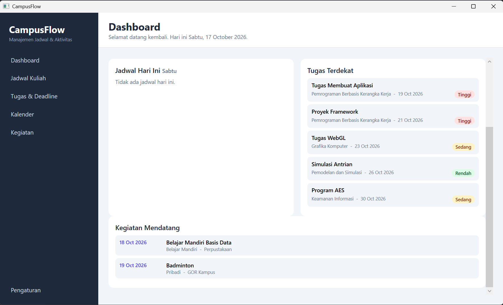

<br>

2. CRUD Jadwal Kuliah

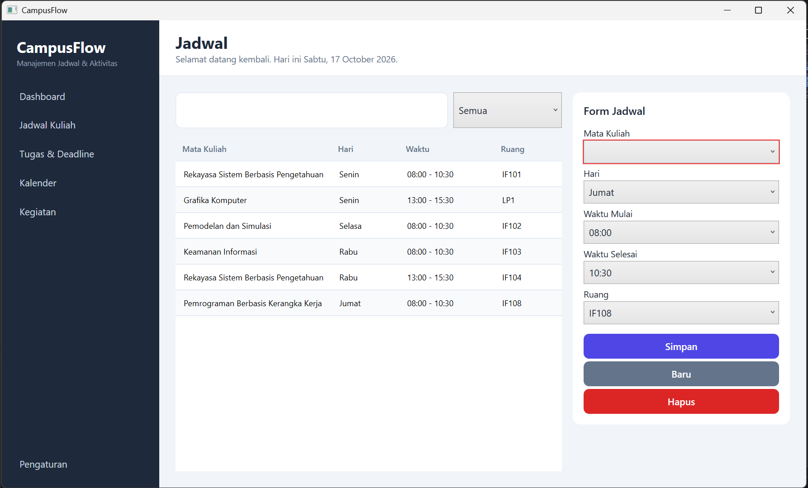

Mendukung fitur pencarian:

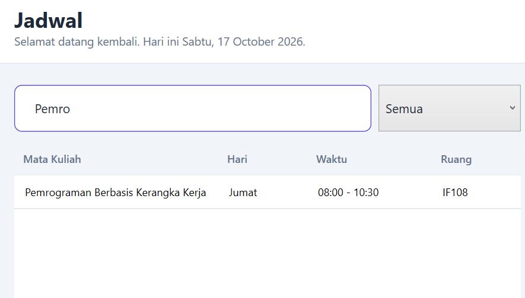

<br>

3. CRUD Tugas

Mendukung fitur CRUD dan pencarian berdasarkan filter maupun keyword:

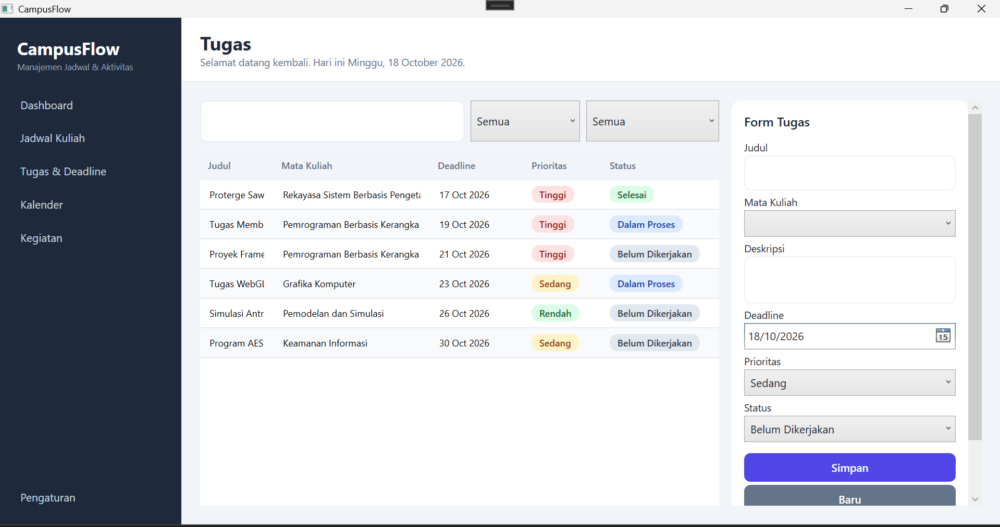

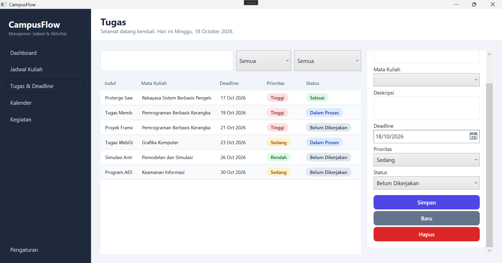

<br>

4. Kalender

Fitur kalender untuk memetakan jadwal kuliah, deadline tugas, dan rencana kegiatan

Grid mingguan:

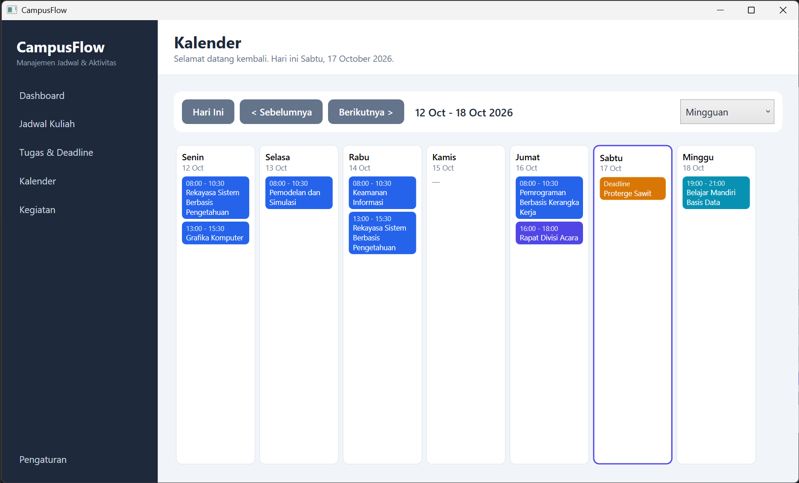

Grid harian:

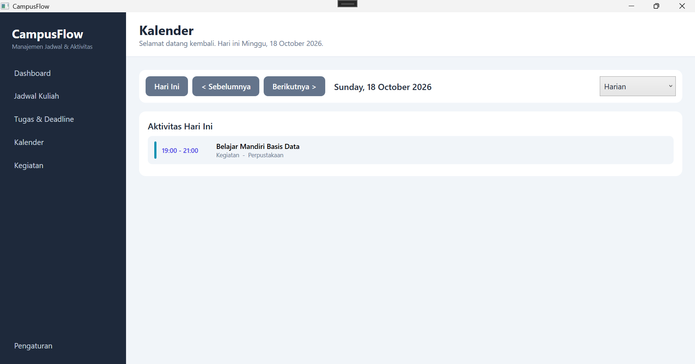

<br>

5. Kegiatan

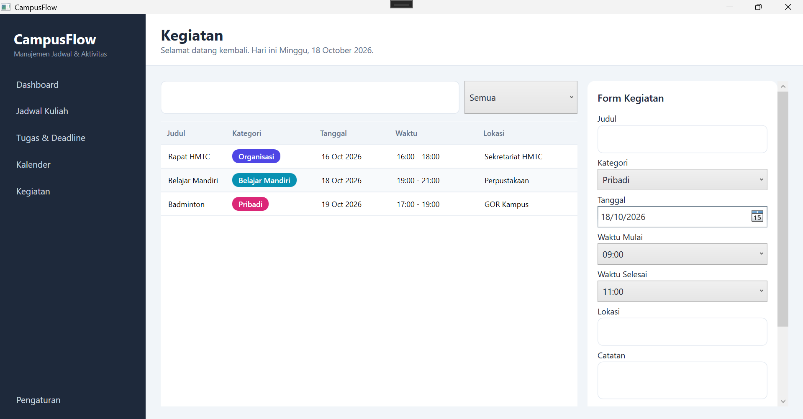

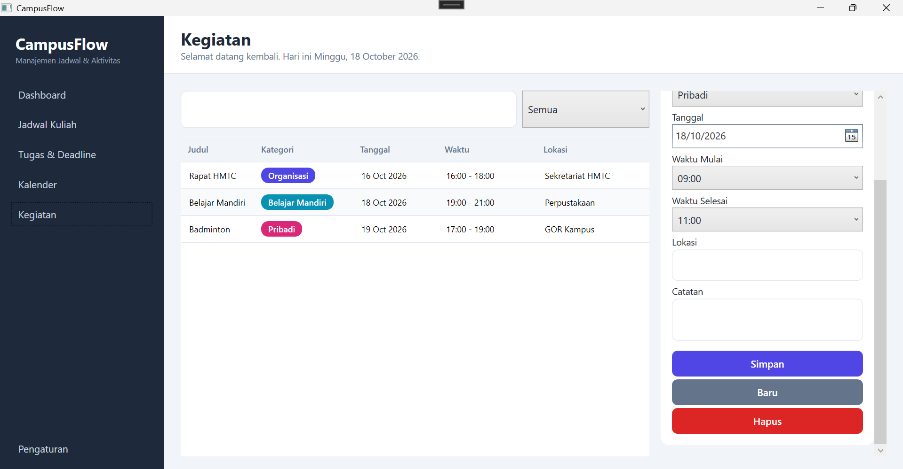

<br>

6. Pengaturan

Fitur untuk uji coba koneksi ke database

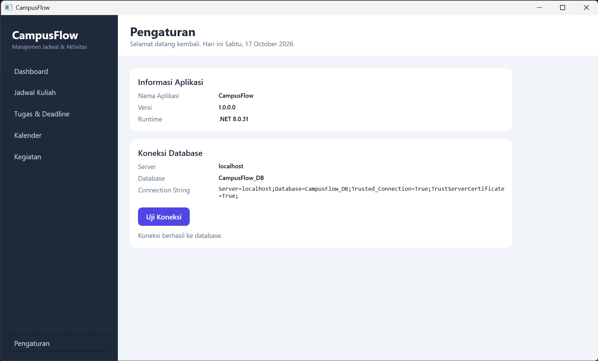

<br>

## Penjelasan Kode

Kode aplikasi berada di folder `Src Code` dan dibangun dengan pola MVVM (Model–View–ViewModel), sehingga tampilan, logika, dan akses database dipisahkan. Pemisahan ini membuat kode lebih mudah dibaca dan dirawat.

| Lapisan | Folder | Isi |
|---|---|---|
| Model | `Models` | Kelas data: `MataKuliah`, `Tugas`, `JadwalKuliah`, `Kegiatan` |
| Repository | `Data` | Query database berparameter (ADO.NET) |
| ViewModel | `ViewModels` | State tampilan, command, dan validasi form |
| View | `Views` | Tampilan XAML |
| Tema | `Themes` | Warna dan style yang dipakai bersama |

Penjelasan per bagian:

- `App.xaml` — titik masuk aplikasi. Memuat `Themes/Theme.xaml` sebagai resource global dan membuka `MainWindow`.
- `appsettings.json` — menyimpan connection string database
- `Data/Db.cs` — membaca connection string tersebut sekali saja, lalu dipakai bersama oleh seluruh repository.
- `Data/*Repository.cs` — berisi query CRUD. Semua query memakai parameterized query untuk mencegah SQL injection, dan dijalankan secara `async` agar UI tidak freeze.
- `ViewModels/MainViewModel.cs` — mengatur navigasi sidebar. Setiap kali halaman dibuka, data halaman tersebut dimuat ulang dari database.
- `ViewModels/*ViewModel.cs` — menangani logika tiap halaman: validasi input, konfirmasi sebelum menghapus, serta menampilkan notifikasi berhasil atau gagal.
- `Views/MainWindow.xaml` — kerangka aplikasi yang berisi sidebar, header, dan area konten. Pemetaan ViewModel ke View dilakukan dengan `DataTemplate`.
- `Converters/ZeroToVisibilityConverter.cs` — menampilkan tulisan seperti "Belum ada tugas" ketika data masih kosong.

Penanganan error dilakukan dengan `try`–`catch` di setiap operasi database, kemudian menampilkan pesan lewat `MessageBox`. Dengan begitu, apabila koneksi database terputus, aplikasi tetap berjalan dan tidak crash.
