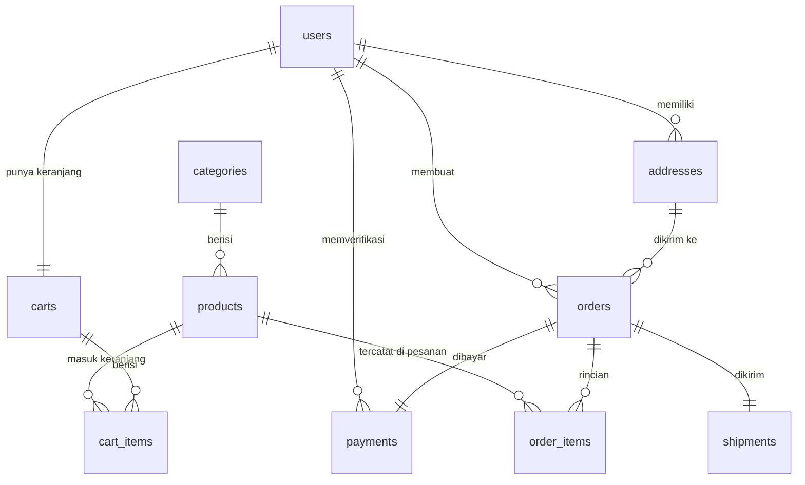
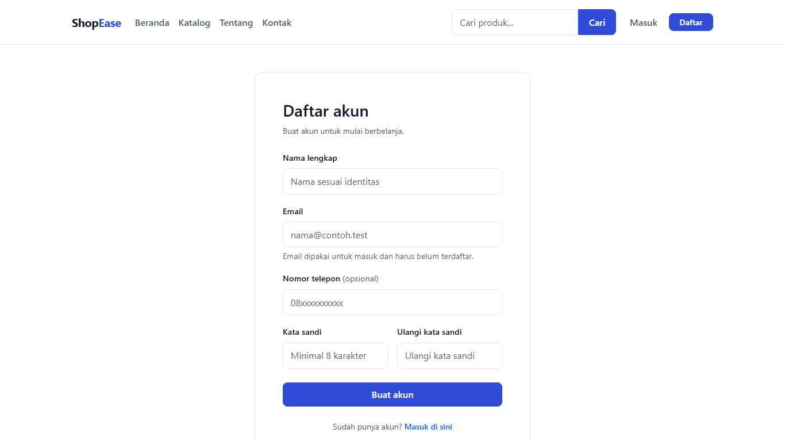
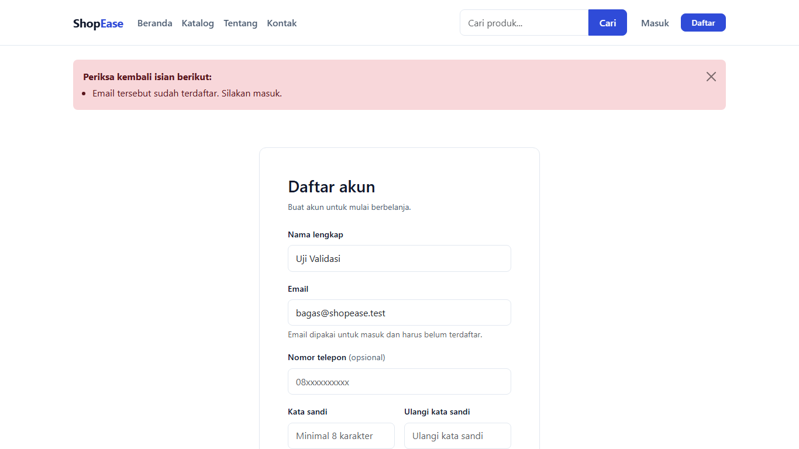
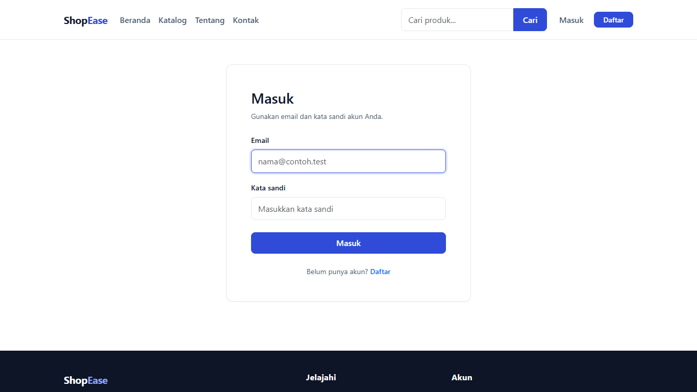
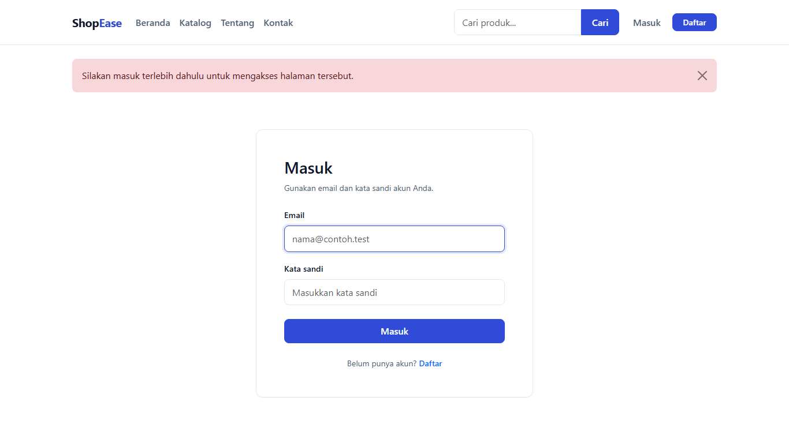

# ShopEase


---

## 1. Identitas Proyek

| Item | Keterangan |
|---|---|
| Nama | **Christina Tan** |
| NRP | **5025241060** |
| Kelas | **PBKK D** |
| Framework | CodeIgniter 4.7.6 (PHP 8.4) |
| Database | MySQL 8.0 |

Laporan ini membahas **model data, struktur database, serta fitur registrasi dan
login** beserta controller yang menanganinya.

---

## 2. Sekilas ShopEase

ShopEase adalah aplikasi toko online sederhana. Pembeli membuka katalog, memasukkan
barang ke keranjang, lalu checkout. Setelah pesanan dibuat, pembeli mengunggah bukti
transfer; admin memverifikasi, operator mengisi data pengiriman.

| Peran | Yang dapat dilakukan |
|---|---|
| Customer | Registrasi, login, katalog, keranjang, checkout, unggah bukti bayar, riwayat pesanan |
| Admin | Kategori, produk, pesanan, verifikasi pembayaran, laporan |
| Operator | Memproses pesanan dan mengisi data pengiriman |

---

## 3. Cara Menjalankan

```bash
composer install
```

Isi `.env`:

```ini
CI_ENVIRONMENT = development
app.baseURL = 'http://localhost:8080/'

database.default.hostname = localhost
database.default.database = db_shopease
database.default.username = root
database.default.password =
database.default.DBDriver = MySQLi
database.default.port = 3306
```

Buat database, jalankan migration, lalu isi data awal:

```bash
mysql -u root -p -e "CREATE DATABASE db_shopease CHARACTER SET utf8mb4 COLLATE utf8mb4_unicode_ci;"
php spark migrate
php spark db:seed DatabaseSeeder
php spark serve
```

---

## 4. Model Data

Setiap tabel punya satu model. Model memegang `$allowedFields`, aturan validasi, dan
query yang dipakai berulang, sehingga controller tidak menulis query sendiri.

| Model | Tabel | Isi | Method penting |
|---|---|---|---|
| `UserModel` | `users` | Akun admin, operator, customer | `findActiveByEmail()`, `customers()` |
| `CategoryModel` | `categories` | Kategori produk | `withProductCount()`, `hasProducts()` |
| `ProductModel` | `products` | Produk, harga, stok, status | `catalog()`, `latestActive()`, `bestSellers()`, `findActive()`, `decreaseStock()` |
| `AddressModel` | `addresses` | Alamat pengiriman customer | `forUser()`, `saveForUser()`, `belongsToUser()` |
| `CartModel` | `carts` | Satu keranjang aktif per customer | `forUser()` |
| `CartItemModel` | `cart_items` | Item keranjang | `withProduct()`, `findInCart()`, `findProductInCart()`, `clearCart()` |
| `OrderModel` | `orders` | Header pesanan + state machine status | `generateOrderNumber()`, `canTransition()`, `detail()`, `adminList()`, `dailySales()`, `report()` |
| `OrderItemModel` | `order_items` | Rincian pesanan (snapshot harga) | `forOrder()`, `countByProduct()` |
| `PaymentModel` | `payments` | Pembayaran manual | `forOrder()`, `waitingVerification()`, `listByStatus()`, `countWaiting()` |
| `ShipmentModel` | `shipments` | Kurir, resi, status kirim | `forOrder()`, `saveForOrder()` |

### Konfigurasi dasar model

Semua model memakai pola yang sama:

```php
class ProductModel extends Model
{
    protected $table            = 'products';
    protected $primaryKey       = 'id';
    protected $useAutoIncrement = true;
    protected $returnType       = 'array';
    protected $useTimestamps    = true;
    protected $allowedFields    = [
        'category_id', 'name', 'slug', 'description', 'price', 'stock', 'image', 'status',
    ];

    protected $validationRules = [
        'category_id' => 'required|is_natural_no_zero',
        'name'        => 'required|min_length[3]|max_length[150]',
        'price'       => 'required|decimal|greater_than_equal_to[0]',
        'stock'       => 'required|is_natural',
        'status'      => 'required|in_list[active,inactive]',
    ];
}
```

Poin penting:

- `$returnType = 'array'`: hasil query berupa array asosiatif, konsisten di semua
  controller dan view (tidak campur objek dan array).
- `$allowedFields`: hanya kolom yang terdaftar yang bisa diinsert/update. Kolom
  seperti `id` dan `created_at` tidak bisa diisi dari input pengguna.
- `$useTimestamps = true`: `created_at` dan `updated_at` diisi otomatis, kecuali
  `order_items` yang hanya butuh waktu dibuat.
- `$validationRules`: validasi tingkat model, dipakai saat `insert()`/`update()`.

### Query pada model

Contoh `OrderModel::canTransition()`: aturan perpindahan status disimpan sekali di
model, bukan disebar ke controller.

```php
public const TRANSITIONS = [
    self::STATUS_PENDING    => [self::STATUS_WAITING, self::STATUS_CANCELLED],
    self::STATUS_WAITING    => [self::STATUS_PROCESSING, self::STATUS_PENDING, self::STATUS_CANCELLED],
    self::STATUS_PROCESSING => [self::STATUS_SHIPPED, self::STATUS_CANCELLED],
    self::STATUS_SHIPPED    => [self::STATUS_COMPLETED],
    self::STATUS_COMPLETED  => [],
    self::STATUS_CANCELLED  => [],
];

public static function canTransition(string $from, string $to): bool
{
    return in_array($to, self::TRANSITIONS[$from] ?? [], true);
}
```

### Pengurangan stok yang aman

Stok tidak dibaca lalu dikurangi dari PHP, karena dua pembeli bisa mengambil stok
yang sama. Pengurangan dilakukan dalam satu pernyataan SQL:

```php
public function decreaseStock(int $productId, int $quantity): bool
{
    return $this->db->table('products')
        ->set('stock', 'stock - ' . $quantity, false)
        ->where('id', $productId)
        ->where('stock >=', $quantity)
        ->update();
}
```

Klausa `stock >= $quantity` membuat update gagal bila stok sudah tidak cukup,
sehingga stok tidak mungkin menjadi negatif.

---

## 5. Struktur Database

10 tabel aplikasi, seluruhnya memakai primary key dan foreign key. Nilai uang
memakai `DECIMAL(12,2)`, bukan `FLOAT`.



### Tabel `users`

| Kolom | Tipe | Keterangan |
|---|---|---|
| `id` | INT UNSIGNED | Primary key, auto increment |
| `name` | VARCHAR(100) | Nama pengguna |
| `email` | VARCHAR(150) | **UNIQUE**, dipakai untuk login |
| `password_hash` | VARCHAR(255) | Hash bcrypt, bukan teks biasa |
| `role` | ENUM('admin','customer','operator') | Default `customer` |
| `phone` | VARCHAR(20) NULL | Opsional |
| `is_active` | TINYINT(1) | Default 1; akun nonaktif tidak bisa login |
| `created_at`, `updated_at` | DATETIME | Diisi otomatis |

### Tabel inti lainnya

| Tabel | Kolom kunci |
|---|---|
| `products` | `category_id` (FK), `name`, `slug` (UNIQUE), `price` DECIMAL(12,2), `stock`, `image`, `status` ENUM('active','inactive') |
| `orders` | `user_id` (FK), `address_id` (FK), `order_number` (UNIQUE), `order_date`, `subtotal`, `shipping_cost`, `total`, `order_status`, `notes` |
| `order_items` | `order_id` (FK), `product_id` (FK), `product_name`, `price`, `quantity`, `subtotal` |
| `payments` | `order_id` (FK), `method`, `amount`, `proof_file`, `payment_status` ENUM('unpaid','submitted','verified','rejected'), `verified_by` (FK), `verified_at` |
| `shipments` | `order_id` (FK), `courier`, `tracking_number`, `shipment_status`, `shipped_at`, `delivered_at` |

### Relasi foreign key

| Tabel | Kolom | Mengacu ke |
|---|---|---|
| `products` | `category_id` | `categories.id` |
| `addresses` | `user_id` | `users.id` |
| `carts` | `user_id` | `users.id` |
| `cart_items` | `cart_id` | `carts.id` |
| `cart_items` | `product_id` | `products.id` |
| `orders` | `user_id` | `users.id` |
| `orders` | `address_id` | `addresses.id` |
| `order_items` | `order_id` | `orders.id` |
| `order_items` | `product_id` | `products.id` |
| `payments` | `order_id` | `orders.id` |
| `payments` | `verified_by` | `users.id` |
| `shipments` | `order_id` | `orders.id` |

### Indexing

- Index dipasang pada kolom yang sering dicari atau diurutkan: `users.email` (unik),
  `categories.slug` (unik), `products.slug` (unik), `products.category_id`,
  `products.status`, `orders.order_number` (unik), `orders.user_id`,
  `orders.order_status`, `orders.order_date`, serta `cart_items (cart_id, product_id)`
  (unik) agar satu produk tidak muncul dua kali di keranjang yang sama.
- `carts.user_id` unik: satu customer hanya punya satu keranjang aktif.

### Migration dan seeder

| File | Isi |
|---|---|
| `app/Database/Migrations/*_CreateUsers.php` | Tabel `users`, unique email, index role |
| `app/Database/Migrations/*_CreateProducts.php` | Tabel `products` + FK kategori |
| `app/Database/Migrations/*_CreateOrders.php` | Tabel `orders` + FK user dan alamat |
| `app/Database/Seeds/DatabaseSeeder.php` | Menjalankan seeder berurutan |
| `app/Database/Seeds/UserSeeder.php` | 1 admin, 1 operator, 2 customer |
| `app/Database/Seeds/CategorySeeder.php` | 4 kategori |
| `app/Database/Seeds/ProductSeeder.php` | 18 produk (2 nonaktif) |
| `app/Database/Seeds/AddressSeeder.php` | 1 alamat per customer |

Urutan seeder penting karena relasi: user → kategori → produk → alamat.

---

## 6. Registrasi User

### Route

| Method | URL | Controller::method | Filter |
|---|---|---|---|
| GET | `/register` | `AuthController::register` | `guest` |
| POST | `/register` | `AuthController::attemptRegister` | `guest` |

```php
$routes->group('', ['filter' => 'guest'], static function (RouteCollection $routes): void {
    $routes->get('register', 'AuthController::register', ['as' => 'register']);
    $routes->post('register', 'AuthController::attemptRegister', ['as' => 'register.attempt']);
});
```

### Validasi

```php
$rules = [
    'name'             => 'required|min_length[3]|max_length[100]',
    'email'            => 'required|valid_email|max_length[150]|is_unique[users.email]',
    'phone'            => 'permit_empty|max_length[20]',
    'password'         => 'required|min_length[8]',
    'password_confirm' => 'required|matches[password]',
];

$messages = [
    'email' => [
        'is_unique' => 'Email tersebut sudah terdaftar. Silakan masuk.',
    ],
    'password_confirm' => [
        'matches' => 'Konfirmasi kata sandi tidak sama.',
    ],
];
```

| Aturan | Alasan |
|---|---|
| `is_unique[users.email]` | Satu email hanya boleh punya satu akun. Dicek di validasi sekaligus dijaga unique index di database |
| `min_length[8]` | Batas minimal kata sandi |
| `matches[password]` | Mencegah salah ketik saat mendaftar |
| `phone` → `permit_empty` | Nomor telepon opsional |

### Penyimpanan

```php
$userModel->insert([
    'name'          => (string) $this->request->getPost('name'),
    'email'         => (string) $this->request->getPost('email'),
    'phone'         => (string) ($this->request->getPost('phone') ?? ''),
    'password_hash' => password_hash((string) $this->request->getPost('password'), PASSWORD_DEFAULT),
    'role'          => 'customer',
    'is_active'     => 1,
]);
```

- Kata sandi **tidak pernah** disimpan apa adanya. `password_hash()` menghasilkan
  bcrypt 60 karakter, terlihat di database sebagai `$2y$12$...`.
- `role` diisi `customer` di sisi server. Pendaftar tidak bisa memilih jadi admin,
  walaupun menambahkan field `role` pada request.
- `is_active = 1` agar akun langsung bisa dipakai login.

Setelah berhasil, pengguna diarahkan ke `/login` dengan pesan sukses. Kalau gagal,
kembali ke formulir dengan daftar error dan isian sebelumnya tetap ada (`old()`).

**Halaman daftar** : `GET /register` · `AuthController::register` · `auth/register.php`



**Validasi gagal** : email yang sudah terdaftar



---

## 7. Login dan Logout

### Route

| Method | URL | Controller::method | Filter |
|---|---|---|---|
| GET | `/login` | `AuthController::login` | `guest` |
| POST | `/login` | `AuthController::attemptLogin` | `guest` |
| POST | `/logout` | `AuthController::logout` | `auth` |

Logout memakai **POST**, bukan tautan, supaya tidak terpicu oleh prefetch browser
atau crawler.

### Alur login

```php
$user = (new UserModel())->findActiveByEmail($email);

if ($user === null || ! password_verify($password, $user['password_hash'])) {
    return redirect()->back()->withInput()
        ->with('error', 'Email atau kata sandi tidak cocok.');
}

$this->session->regenerate();
$this->session->set([
    'user_id'   => (int) $user['id'],
    'name'      => $user['name'],
    'email'     => $user['email'],
    'role'      => $user['role'],
    'logged_in' => true,
]);

$target = in_array($user['role'], ['admin', 'operator'], true) ? 'admin/dashboard' : '';

return redirect()->to(site_url($target))->with('success', 'Selamat datang, ' . $user['name'] . '.');
```

Poin penting:

- `findActiveByEmail()` menyaring `is_active = 1`, jadi akun yang dinonaktifkan
  langsung ditolak walaupun kata sandinya benar.
- `password_verify()` membandingkan kata sandi dengan hash bcrypt di database.
- **Pesan gagal dibuat generik.** Email tidak terdaftar dan kata sandi salah
  menghasilkan pesan yang sama, agar tidak bisa dipakai menebak email mana yang ada.
- `session()->regenerate()` membuat ID session baru setelah login, untuk mencegah
  *session fixation* (penyerang menyiapkan ID session lalu memakainya).
- Redirect mengikuti peran: admin dan operator ke `/admin/dashboard`, customer ke
  beranda.

### Isi session setelah login

| Key | Isi | Dipakai oleh |
|---|---|---|
| `user_id` | ID pengguna | `BaseController::userId()`, query kepemilikan data |
| `name` | Nama tampilan | Navbar, sapaan |
| `email` | Email | Ditampilkan di area admin |
| `role` | `admin` / `operator` / `customer` | `AuthFilter`, `GuestFilter`, menu sidebar |
| `logged_in` | `true` | Penanda utama sudah login |

### Logout

```php
public function logout()
{
    $this->session->destroy();

    return redirect()->to(site_url('/'))->with('info', 'Anda telah keluar dari akun.');
}
```

`session()->destroy()` menghapus seluruh data session, bukan hanya `logged_in`,
sehingga tidak ada sisa data yang bisa dipakai ulang.

**Halaman masuk** : `GET /login` · `AuthController::login` · `auth/login.php`



---

## 8. Pembatasan Akses

Registrasi dan login hanya berguna kalau halaman lain benar-benar dijaga. Dua filter
mengerjakan itu:

| Filter | Perilaku |
|---|---|
| `GuestFilter` | Halaman login/register hanya untuk guest. Pengguna yang sudah login diarahkan ke beranda atau dashboard sesuai peran |
| `AuthFilter` | Wajib login. Bila belum, redirect ke `/login`. Bila peran tidak sesuai argumen, dikembalikan **403** |

```php
$allowedRoles = is_array($arguments) ? $arguments : [];

if ($allowedRoles !== [] && ! in_array((string) $session->get('role'), $allowedRoles, true)) {
    $response = service('response');
    $response->setStatusCode(ResponseInterface::HTTP_FORBIDDEN);
    $response->setBody(view('errors/html/error_403', [
        'title'   => 'Akses Ditolak',
        'message' => 'Role akun Anda tidak memiliki izin untuk membuka halaman ini.',
    ]));

    return $response;
}
```

Perbedaan perlakuan:

| Keadaan | Perlakuan | Alasan |
|---|---|---|
| Belum login | Redirect ke `/login` | Pengguna wajar diarahkan masuk |
| Sudah login, peran salah | 403 halaman kustom | URL yang ditolak tetap terlihat, bukan disembunyikan lewat redirect |

Pemakaian pada route:

```php
$routes->post('logout', 'AuthController::logout', ['as' => 'logout', 'filter' => 'auth']);
$routes->group('admin', ['filter' => 'auth:admin,operator'], ...);
$routes->group('admin', ['filter' => 'auth:admin'], ...);
```

**Akses halaman terkunci tanpa login** : `/cart` diarahkan ke `/login`



---

## 9. Ringkasan Data Awal

| Tabel | Jumlah baris |
|---|---|
| `users` | 4 (1 admin, 1 operator, 2 customer) |
| `categories` | 4 |
| `products` | 18 (16 aktif, 2 nonaktif) |
| `addresses` | 2 (satu per customer) |
