# PBKK: Framework CodeIgniter (Latihan 1 & 2)

Nama : Christina Tan

NRP : 5025241060

Di latihan ini saya memakai **CodeIgniter 4 versi 4.7.6** untuk mengerjakan tiga aplikasi sekaligus: **KosKu** (manajemen rumah kos), **SIAKAD** (sistem informasi akademik), dan **ThriftIn** (toko thrift online). Alasannya karena CodeIgniter 4 masih memakai pola MVC yang sama seperti materi kuliah, tetapi sudah memakai Composer, namespace, dan migration bawaan, jadi tidak perlu menyusun struktur folder dari nol seperti di CI3. Ketiga aplikasi berjalan bersamaan di localhost dengan port berbeda (8081, 8082, 8083) dan database terpisah, sehingga bisa dibandingkan tanpa saling mengganggu.

Sebagian besar materi Latihan 1 ditulis untuk CodeIgniter 3, jadi ada beberapa penyesuaian yang saya lakukan: `$this->load->model()` diganti pemanggilan model dengan namespace, `$this->load->view()` diganti helper `view()`, aturan validasi dipindah ke properti model, dan `routes.php` memakai closure/grup dengan filter. Semua perbedaan yang saya temui saya catat di bagian penutup.

## Daftar Isi

- [Sekilas CodeIgniter dan MVC](#sekilas-codeigniter-dan-mvc)
- [1. Kode-Kode Penting Aplikasi dan Penjelasannya](#1-kode-kode-penting-aplikasi-dan-penjelasannya)
  - [1.1 Latihan 1: KosKu](#11-latihan-1-kosku)
  - [1.2 Latihan 2a: SIAKAD](#12-latihan-2a-siakad)
  - [1.3 Latihan 2b: ThriftIn](#13-latihan-2b-thriftin)
- [2. Langkah Instalasi CodeIgniter dan Konfigurasinya](#2-langkah-instalasi-codeigniter-dan-konfigurasinya)
- [3. Model Data](#3-model-data)
- [Penutup](#penutup)

## Sekilas CodeIgniter dan MVC

CodeIgniter memisahkan pekerjaan menjadi tiga bagian. **Model** mengurus data dan aturan yang berhubungan dengan tabel (validasi, relasi, perhitungan). **View** hanya menampilkan HTML dan sedapat mungkin tidak berisi logika bisnis. **Controller** menerima request, memanggil model, lalu menentukan view mana yang ditampilkan. Pola ini terasa berguna saat aplikasi mulai besar: ketika saya menambah fitur verifikasi pembayaran di KosKu, yang berubah hanya controller dan satu method di model, halaman lain tidak ikut tersentuh.

| Perangkat | Versi / Keterangan |
|---|---|
| Framework | CodeIgniter 4.7.6 (Composer `codeigniter4/appstarter`) |
| PHP | 8.4.13 (CLI), ekstensi `intl`, `mbstring`, `mysqlnd`, `mysqli`, `curl`, `json`, `fileinfo`, `gd` aktif |
| Environment lokal | Laragon (PHP, MySQL, Composer, Node) |
| Database | MySQL 8.0.43 |
| Tampilan publik/toko | Bootstrap 5.3.3 (disimpan lokal di `public/assets`) |
| Tampilan admin | SB Admin 2 versi 4.1.4 (disimpan lokal) |
| Dependency manager | Composer 2.8.12, npm 10.9.3 |

Halaman welcome bawaan CodeIgniter 4 yang saya pakai untuk memastikan instalasi berhasil:


*Gambar 1. Halaman welcome CodeIgniter 4 pada project KosKu*

## 1. Kode-Kode Penting Aplikasi dan Penjelasannya

### 1.1 Latihan 1: KosKu

KosKu adalah aplikasi manajemen kos dengan dua role: **admin** (pemilik kos) dan **penghuni**. Pengunjung bisa melihat kamar tanpa login, sedangkan pengelolaan kamar, penghuni, tagihan, dan akun ada di panel admin yang memakai SB Admin 2.

#### Router dan Controller

Rute dipisah menjadi tiga kelompok: publik, admin, dan penghuni. Grup admin memakai dua filter sekaligus, `auth` dan `role:admin`, sehingga satu baris konfigurasi sudah menutup seluruh halaman pengelolaan dari pengguna yang salah.

```php
$routes->get('/', 'Pages::index');
$routes->get('kamar', 'Kamar::index');
$routes->get('kamar/(:segment)', 'Kamar::detail/$1');

$routes->group('admin', ['filter' => ['auth', 'role:admin'], 'namespace' => 'App\Controllers\Admin'], static function ($routes) {
    $routes->get('dashboard', 'Dashboard::index');
    $routes->get('kamar', 'Kamar::index');
    $routes->post('kamar', 'Kamar::store');
    $routes->get('kamar/(:num)/edit', 'Kamar::edit/$1');
    $routes->post('kamar/(:num)', 'Kamar::update/$1');
    $routes->post('kamar/(:num)/delete', 'Kamar::delete/$1');
    // ...
});
```

Perhatikan bahwa hapus data memakai `POST`, bukan tautan `GET`. Ini penting karena tautan `GET` bisa dipicu oleh crawler atau prefetch browser, sedangkan `POST` bisa dilindungi CSRF.

Controller `Kamar` di sisi publik memakai slug pada URL. Kalau slug tidak ada di database, aplikasi melempar `PageNotFoundException` supaya pengguna mendapat halaman 404 yang rapi, bukan halaman kosong.

```php
public function detail($slug = null)
{
    $kamarModel = new KamarModel();
    $kamar      = $kamarModel->cariBerdasarkanSlug((string) $slug);

    if ($kamar === null) {
        // Slug tidak ditemukan -> halaman 404 kustom.
        throw new \CodeIgniter\Exceptions\PageNotFoundException('Kamar "' . $slug . '" tidak ditemukan.');
    }

    return view('kamar/detail', [
        'title' => 'Kamar ' . $kamar['nomor_kamar'],
        'kamar' => $kamar,
    ]);
}
```

#### Bootstrap & View Layout

Halaman publik memakai satu layout `layouts/public.php` berisi navbar, area flash message, dan footer. Setiap halaman cukup meng-extend layout itu dan mengisi section `content`, sehingga navbar dan footer tidak perlu ditulis ulang.

```php
<?= $this->extend('layouts/public') ?>

<?= $this->section('content') ?>

<section class="hero">
    <div class="container">
        <h1 class="display-5 fw-bold mb-3">Tinggal nyaman, bayar kos jadi lebih rapi.</h1>
        <a href="<?= site_url('kamar') ?>" class="btn btn-warning fw-semibold px-4">Lihat Kamar Kosong</a>
    </div>
</section>

<?= $this->endSection() ?>
```

Saya juga memisahkan kartu kamar menjadi partial `partials/kartu_kamar.php` karena kartu yang sama dipakai di beranda dan halaman daftar kamar. Satu hal yang sempat membuat error: `$this->include('partial', $data)` di CI4 tidak meneruskan `$data` ke partial, jadi saya memakai helper `view()` di dalam view.

Hasil tampilannya seperti berikut.

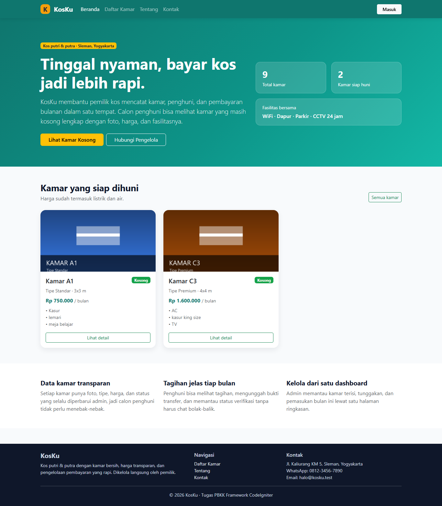

*Gambar 2. Beranda publik KosKu dengan hero, statistik kamar, dan kartu kamar*

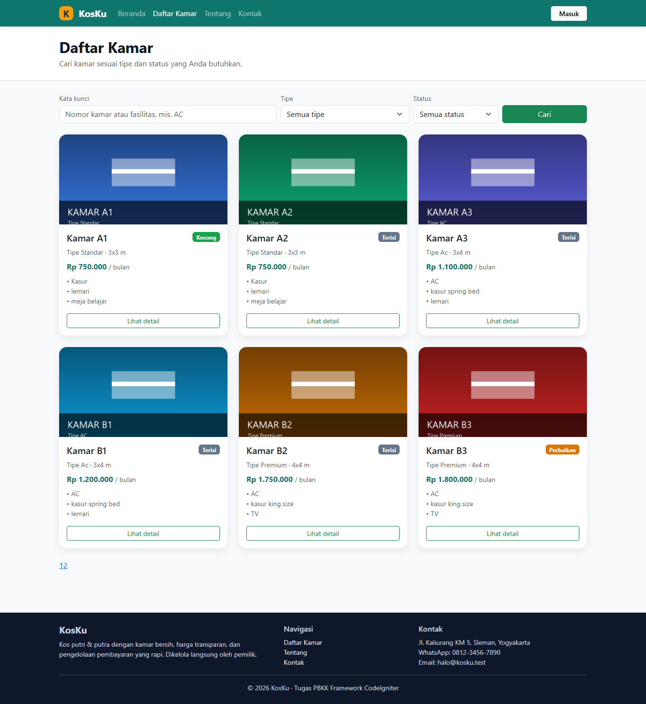

*Gambar 3. Daftar kamar dengan pencarian, filter tipe/status, dan pagination*

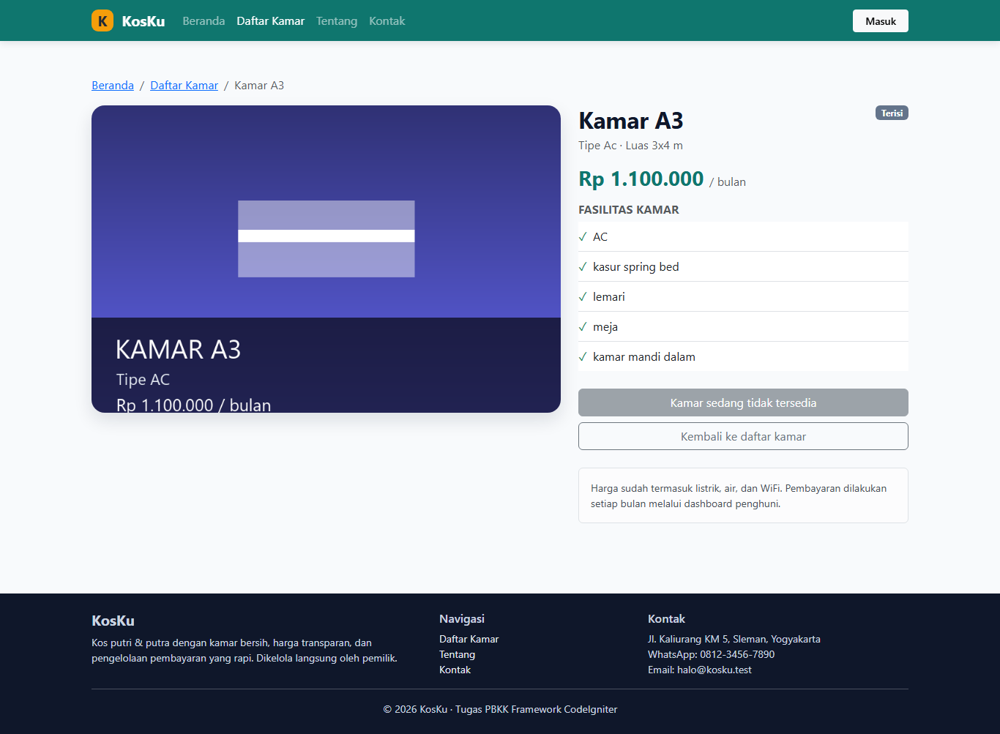

*Gambar 4. Halaman detail kamar beserta fasilitas dan harga*

#### Template SB Admin 2

SB Admin 2 saya unduh lewat npm (`npm pack startbootstrap-sb-admin-2`), lalu folder `css`, `js`, `img`, dan `vendor` disalin ke `public/assets/sbadmin/`. Template aslinya satu file HTML panjang; saya pecah menjadi tiga bagian supaya menu bisa menyesuaikan role:

- `layouts/admin.php` sebagai pembungkus (wrapper, topbar, footer, script),
- `partials/sidebar.php` untuk menu,
- `partials/topbar.php` untuk nama pengguna dan tombol keluar.

Menu sidebar dibentuk dari array yang berbeda per role, jadi penghuni tidak pernah melihat menu pengelolaan sama sekali.

```php
$menuAdmin = [
    ['url' => 'admin/dashboard', 'label' => 'Dashboard', 'ikon' => 'fa-tachometer-alt'],
    ['url' => 'admin/kamar', 'label' => 'Kamar', 'ikon' => 'fa-door-open'],
    ['url' => 'admin/penghuni', 'label' => 'Penghuni', 'ikon' => 'fa-users'],
    ['url' => 'admin/pembayaran', 'label' => 'Pembayaran', 'ikon' => 'fa-money-bill-wave'],
    ['url' => 'admin/users', 'label' => 'Pengguna', 'ikon' => 'fa-user-cog'],
];

$menuPenghuni = [
    ['url' => 'penghuni/dashboard', 'label' => 'Dashboard', 'ikon' => 'fa-tachometer-alt'],
    ['url' => 'penghuni/tagihan', 'label' => 'Tagihan Saya', 'ikon' => 'fa-file-invoice-dollar'],
];

$menu = $role === 'admin' ? $menuAdmin : $menuPenghuni;
```

Dashboard admin menampilkan empat kartu statistik, grafik pemasukan dari Chart.js bawaan template, dan tabel pembayaran terbaru. Angka grafik diambil dari total tagihan berstatus `lunas` per bulan pada tahun berjalan.

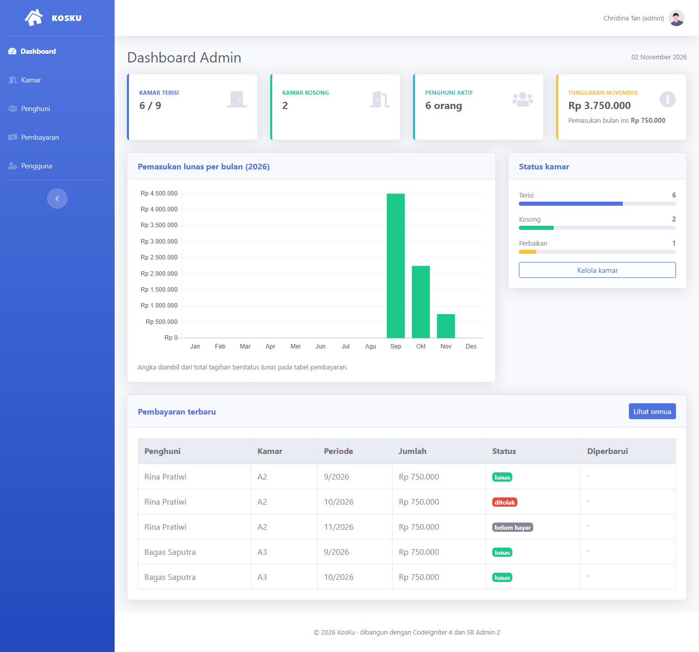

*Gambar 5. Dashboard admin KosKu dengan kartu statistik dan grafik pemasukan*

#### Model dan CRUD

Model `KamarModel` mendefinisikan kolom yang boleh diisi, aturan validasi berbahasa Indonesia, dan pembuatan slug otomatis. Dengan `$allowedFields`, field yang tidak didaftarkan tidak akan ikut tersimpan meskipun dikirim lewat form, sehingga lebih aman daripada menerima seluruh isi `$_POST`.

```php
protected $allowedFields = [
    'nomor_kamar', 'slug', 'tipe', 'harga_bulanan',
    'luas', 'fasilitas', 'status', 'foto',
];

protected $useTimestamps = true;

protected $validationRules = [
    'nomor_kamar'   => 'required|max_length[20]',
    'tipe'          => 'required|in_list[standar,ac,premium]',
    'harga_bulanan' => 'required|integer|greater_than[0]',
    'luas'          => 'permit_empty|max_length[20]',
    'status'        => 'required|in_list[kosong,terisi,perbaikan]',
];

protected $validationMessages = [
    'nomor_kamar' => ['required' => 'Nomor kamar wajib diisi.'],
    'harga_bulanan' => [
        'required'     => 'Harga bulanan wajib diisi.',
        'integer'      => 'Harga harus berupa angka.',
        'greater_than' => 'Harga harus lebih besar dari nol.',
    ],
];
```

Slug dibuat dari nomor kamar dan dicek keunikan-nya dalam satu method. Kamar `A1` menjadi `kamar-a1`; kalau ternyata sudah dipakai, ditambahkan `-2`, `-3`, dan seterusnya.

```php
public function buatSlug(string $nomorKamar, ?int $abaikanId = null): string
{
    $dasar = 'kamar-' . url_title($nomorKamar, '-', true);
    $slug  = $dasar;
    $urut  = 2;

    while (true) {
        $query = $this->where('slug', $slug);
        if ($abaikanId !== null) {
            $query->where('id !=', $abaikanId);
        }

        if ($query->countAllResults() === 0) {
            return $slug;
        }

        $slug = $dasar . '-' . $urut;
        $urut++;
    }
}
```

Controller admin memakai pola yang konsisten untuk semua modul: validasi dulu, cek duplikat, baru simpan. Kalau validasi gagal, pengguna dikembalikan ke form dengan `withInput()` dan pesan error per field, sehingga isian tidak hilang.

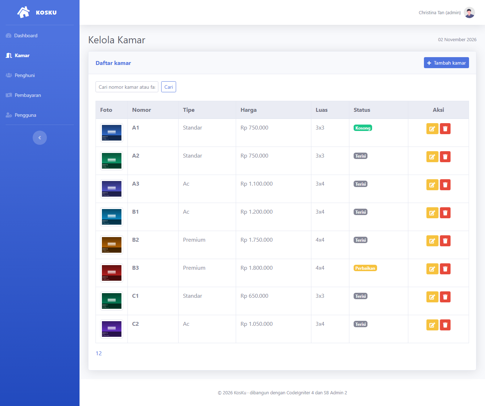

*Gambar 6. Daftar kamar di panel admin dengan pencarian dan pagination*

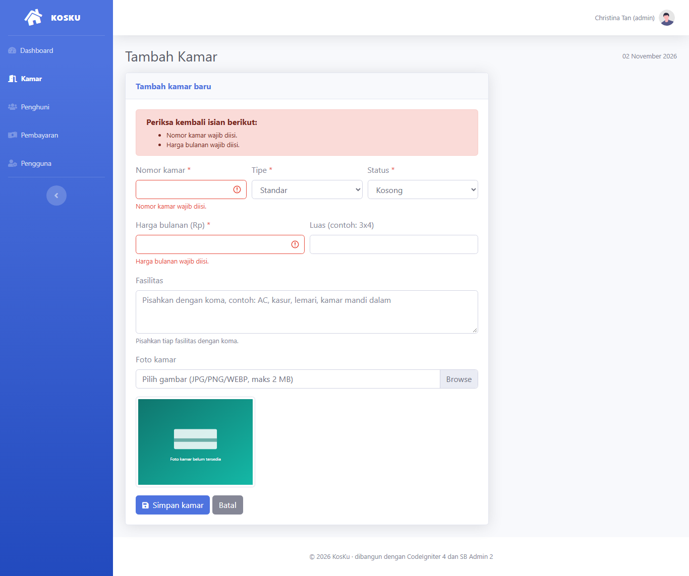

*Gambar 7. Form kamar menampilkan pesan validasi berbahasa Indonesia*

Daftar penghuni dan pengelolaan tagihan memakai pola yang sama, ditambah aturan bisnis: menambah penghuni aktif otomatis mengubah status kamar menjadi `terisi`, dan menandai penghuni keluar mengembalikan kamar menjadi `kosong`.

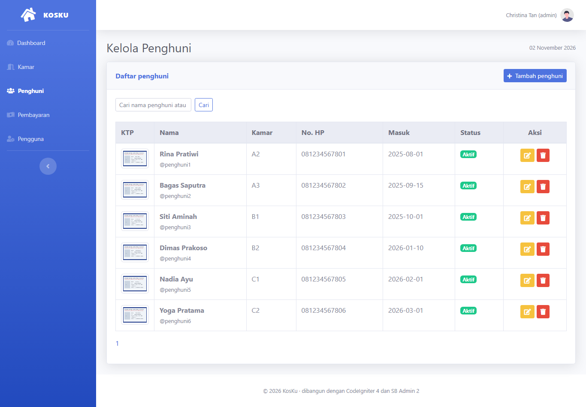

*Gambar 8. Daftar penghuni dengan foto KTP, kamar, dan status*

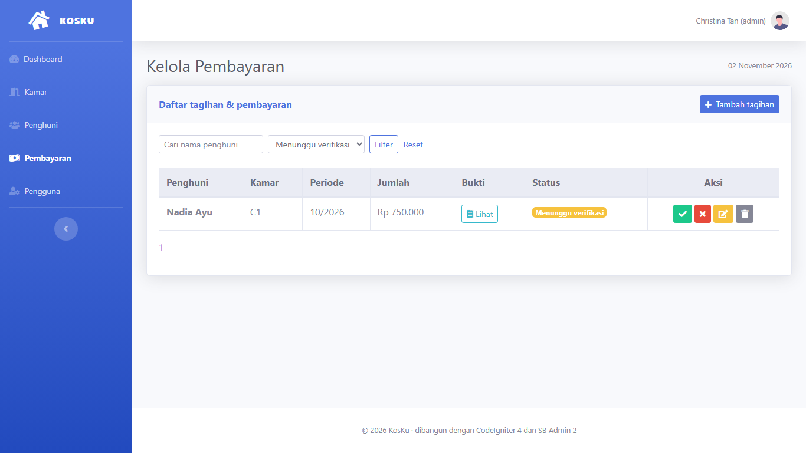

*Gambar 9. Halaman pembayaran admin untuk verifikasi bukti transfer*

#### Penanganan File Upload

Ada tiga jenis upload: foto kamar (publik), foto KTP, dan bukti transfer. Validasi dibuat eksplisit di controller supaya pesan error bisa berbahasa Indonesia.

```php
$aturan['foto'] = 'is_image[foto]|mime_in[foto,image/jpg,image/jpeg,image/png,image/webp]|max_size[foto,2048]';

// ...
$fotoBaru = simpan_upload($file, self::FOLDER_FOTO);
```

Helper `simpan_upload()` memakai nama file acak dari CodeIgniter, jadi dua berkas dengan nama sama tidak saling menimpa.

```php
function simpan_upload($file, string $folder, string $awalan = ''): ?string
{
    if ($file === null || ! $file->isValid() || $file->hasMoved()) {
        return null;
    }

    if (! is_dir($folder)) {
        mkdir($folder, 0777, true);
    }

    $nama = $awalan . $file->getRandomName();
    $file->move($folder, $nama);

    return $nama;
}
```

Foto lama baru dihapus setelah update berhasil. Urutan ini sengaja dipilih supaya kalau update gagal, foto lama tidak hilang lebih dulu.

```php
if ($fotoBaru !== null) {
    hapus_berkas($kamar['foto'] === null ? null : self::FOLDER_FOTO . $kamar['foto']);
}
```

Foto KTP dan bukti transfer **tidak** disimpan di folder publik. Keduanya ada di `writable/uploads/` dan hanya bisa dibuka lewat controller `Berkas` yang memeriksa hak akses.

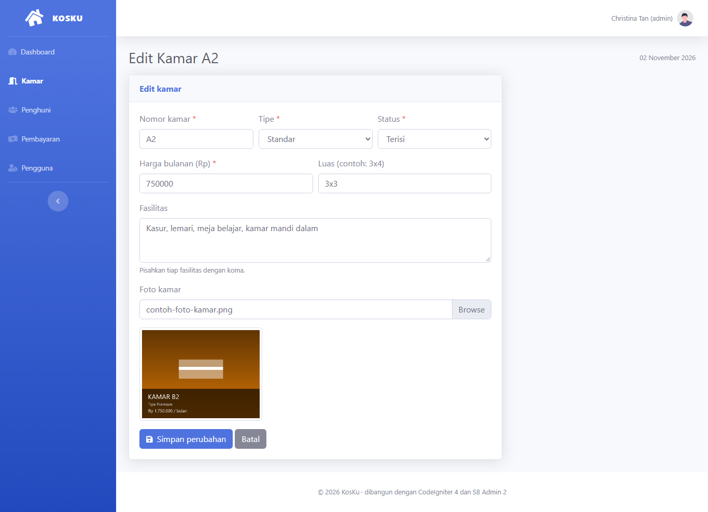

*Gambar 10. Form edit kamar dengan pratinjau foto sebelum disimpan*

Pratinjau foto memakai `FileReader` di browser, jadi pengguna melihat gambar pilihan sebelum menekan simpan.

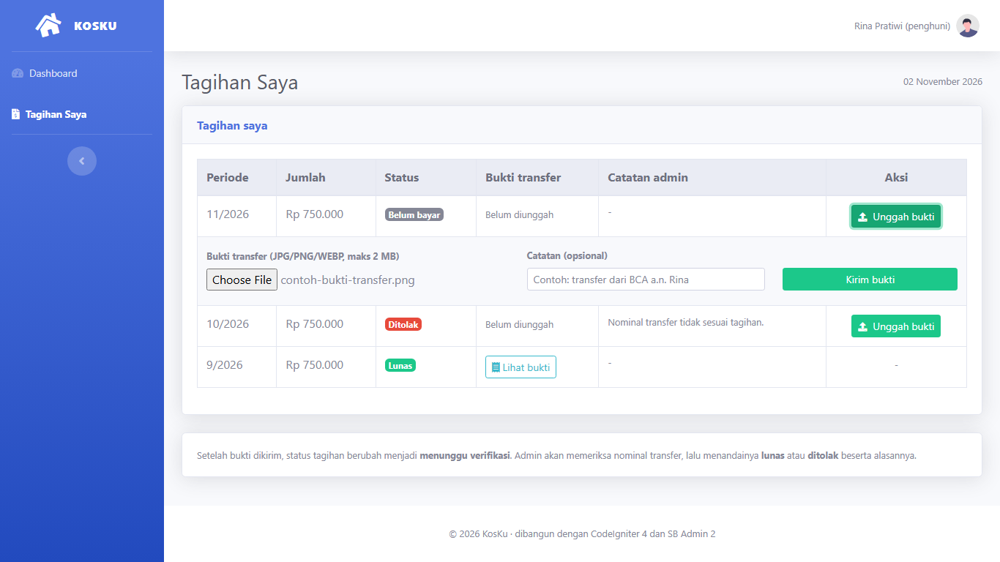

*Gambar 11. Penghuni mengunggah bukti transfer pada halaman tagihan*

#### Akses User (Auth & Role)

Login memakai satu halaman untuk dua role. Setelah kredensial cocok, session ID diregenerasi untuk mencegah session fixation, lalu data penting pengguna disimpan di session.

```php
$user = (new UserModel())->cariBerdasarkanUsername($username);

if ($user === null || ! password_verify($password, $user['password'])) {
    return redirect()->back()
        ->withInput()
        ->with('error', 'Username atau password salah. Silakan coba lagi.');
}

// Regenerasi session ID setelah login (mencegah session fixation).
session()->regenerate(true);
session()->set([
    'user_id'  => (int) $user['id'],
    'nama'     => $user['nama'],
    'role'     => $user['role'],
    'username' => $user['username'],
]);
```

Pembatasan role tidak hanya disembunyikan di tampilan. `RoleFilter` menghentikan request sebelum controller dijalankan, lalu mengembalikan halaman 403.

```php
public function before(RequestInterface $request, $arguments = null)
{
    $role = session()->get('role');

    if ($role === null || $arguments === null || ! in_array($role, $arguments, true)) {
        $response = service('response');
        $response->setStatusCode(403);
        $response->setBody(view('errors/html/error_403', [
            'role' => $role ?? 'tamu',
        ]));

        return $response;
    }

    return null;
}
```

| Fitur | admin (pemilik kos) | penghuni |
|---|---|---|
| Dashboard statistik | kamar terisi/kosong, penghuni aktif, tunggakan, pemasukan bulan ini | kamar sendiri & status tagihan |
| CRUD kamar (+ foto) | Ya | Tidak |
| CRUD penghuni (+ foto KTP) | Ya | Tidak |
| Kelola pembayaran | Ya | Tidak |
| Lihat tagihan sendiri | n/a | Ya |
| Upload bukti transfer | n/a | Ya |
| Kelola akun user | Ya | Tidak |

Halaman login dan bukti penolakan akses:

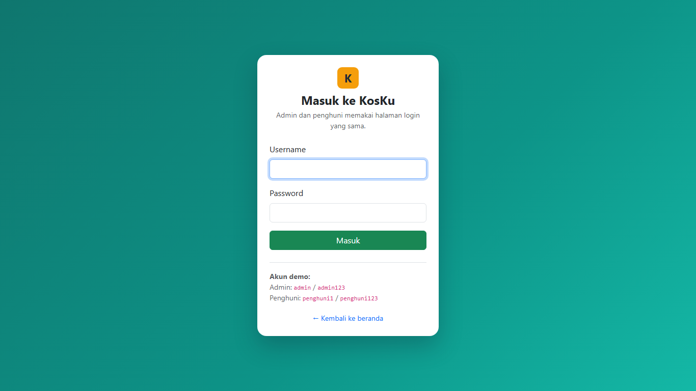

*Gambar 12. Halaman login KosKu beserta akun demo*

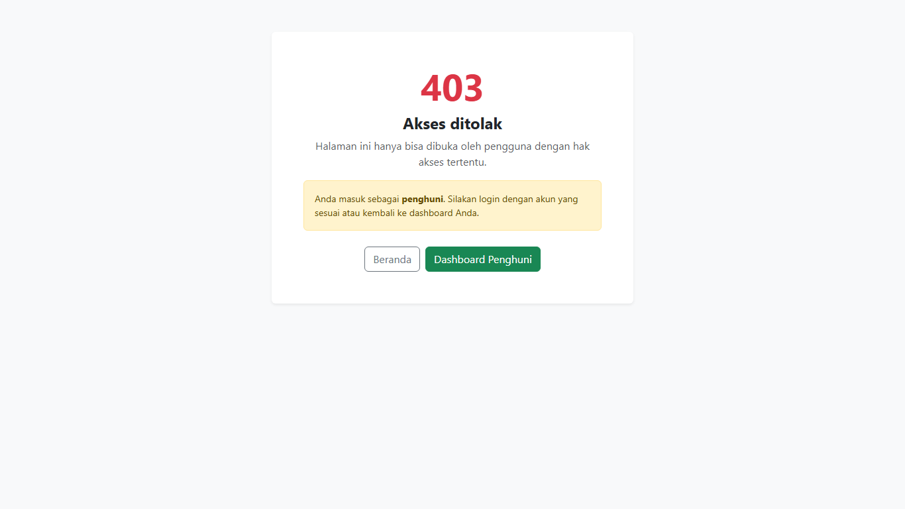

*Gambar 13. Penghuni membuka halaman admin dan ditolak dengan halaman 403*

Penghuni punya dashboard sendiri yang hanya menampilkan kamar dan tagihannya, dan halaman ini tetap memakai layout admin yang sama agar konsisten.

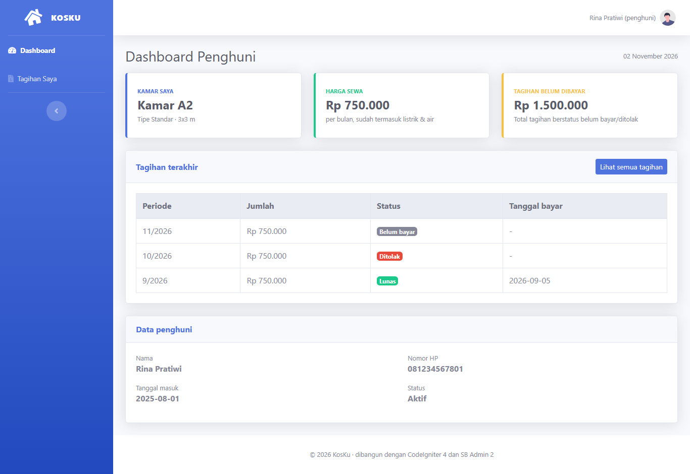

*Gambar 14. Dashboard penghuni berisi kamar dan ringkasan tagihan*

Tampilan mobile beranda saya cek terpisah karena banyak calon penghuni membuka dari ponsel:

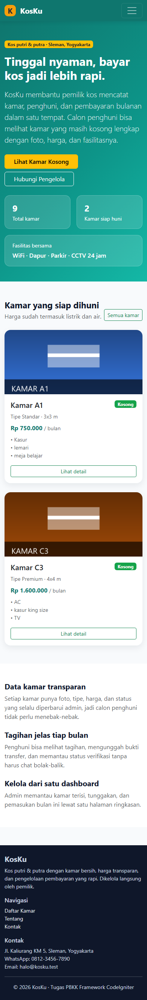

*Gambar 15. Beranda KosKu pada viewport mobile 390x844*

### 1.2 Latihan 2a: SIAKAD

SIAKAD punya tiga role dengan kebutuhan berbeda. Admin mengurus master data, dosen mengurus nilai, mahasiswa mengisi KRS dan melihat hasil studi.

| Role | Fitur |
|---|---|
| **admin** | CRUD mahasiswa, dosen, mata kuliah, program studi; atur dosen wali |
| **dosen** | Lihat kelas yang diampu, input nilai mahasiswa, lihat mahasiswa perwalian |
| **mahasiswa** | Lihat profil, isi KRS, lihat KHS per semester + IPK, cetak KRS/KHS |

Rute dipisah per role dengan filter yang sama seperti KosKu, tetapi kali ini argumen filternya berbeda untuk tiap grup.

```php
$routes->group('admin', ['filter' => ['auth', 'role:admin'], 'namespace' => 'App\Controllers\Admin'], static function ($routes) {
    $routes->get('mahasiswa', 'Mahasiswa::index');
    $routes->post('mahasiswa', 'Mahasiswa::store');
    // ...
});

$routes->group('dosen', ['filter' => ['auth', 'role:dosen'], 'namespace' => 'App\Controllers\Dosen'], static function ($routes) {
    $routes->get('kelas', 'Nilai::index');
    $routes->get('nilai/(:num)', 'Nilai::form/$1');
    $routes->post('nilai/(:num)', 'Nilai::simpan/$1');
    $routes->get('perwalian', 'Perwalian::index');
});

$routes->group('mahasiswa', ['filter' => ['auth', 'role:mahasiswa'], 'namespace' => 'App\Controllers\Mahasiswa'], static function ($routes) {
    $routes->get('krs', 'Krs::index');
    $routes->post('krs', 'Krs::simpan');
    $routes->get('khs', 'Khs::index');
    $routes->get('khs/cetak', 'Khs::cetak');
});
```

Halaman login dan dashboard admin:

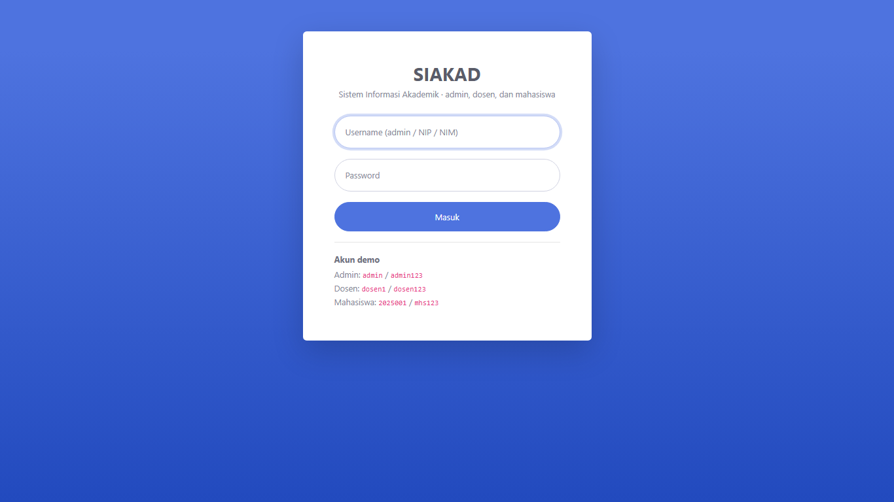

*Gambar 16. Halaman login SIAKAD dengan daftar akun demo*

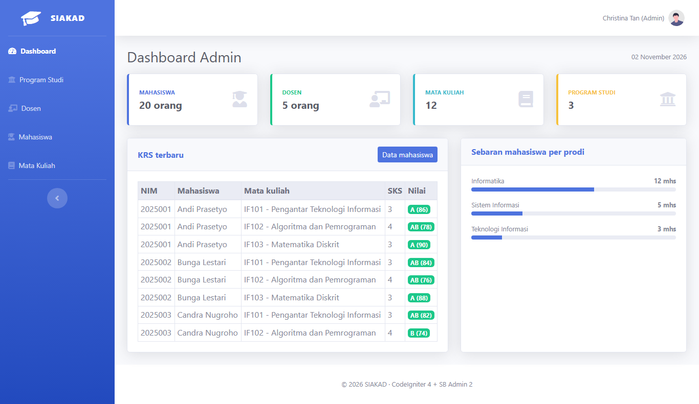

*Gambar 17. Dashboard admin SIAKAD berisi jumlah mahasiswa, dosen, mata kuliah, dan KRS terbaru*

#### Pembuatan akun otomatis dalam satu transaksi

Saat admin menambah mahasiswa, dua tabel berubah sekaligus: `users` dan `mahasiswa`. Kalau salah satu gagal, kondisi setengah jadi akan menyulitkan (misalnya akun ada tetapi profil tidak). Karena itu keduanya dibungkus transaksi, dengan username = NIM dan password awal = NIM yang langsung di-hash.

```php
$db = db_connect();
$db->transStart();

$user->insert([
    'nama'     => (string) $this->request->getPost('nama'),
    'username' => $nim,
    'password' => password_hash($nim, PASSWORD_DEFAULT),
    'role'     => 'mahasiswa',
]);

$mahasiswa->insert([
    'user_id'       => (int) $user->getInsertID(),
    'prodi_id'      => (int) $this->request->getPost('prodi_id'),
    'dosen_wali_id' => $dosenWali === '' ? null : (int) $dosenWali,
    'nim'           => $nim,
    'nama'          => (string) $this->request->getPost('nama'),
    'angkatan'      => (int) $this->request->getPost('angkatan'),
    'alamat'        => (string) $this->request->getPost('alamat'),
    'no_hp'         => (string) $this->request->getPost('no_hp'),
]);

$db->transComplete();

if ($db->transStatus() === false) {
    return redirect()->back()->withInput()
        ->with('errors', ['umum' => 'Gagal menyimpan mahasiswa. Perubahan dibatalkan.']);
}
```

Daftar mahasiswa dan form tambahnya:

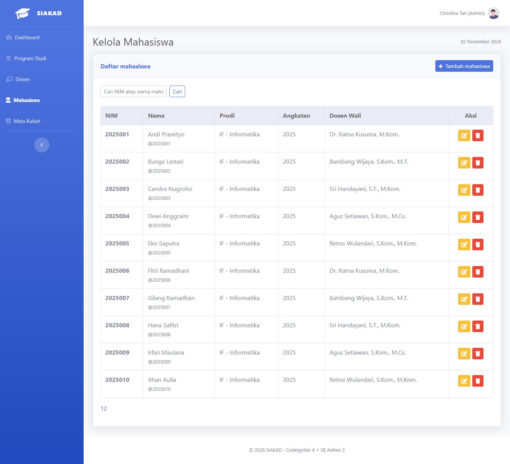

*Gambar 18. Daftar mahasiswa dengan NIM, prodi, dan dosen wali*

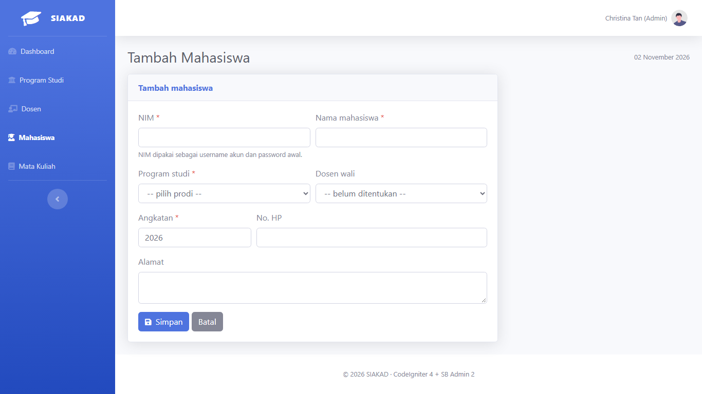

*Gambar 19. Form tambah mahasiswa dengan pilihan prodi dan dosen wali*

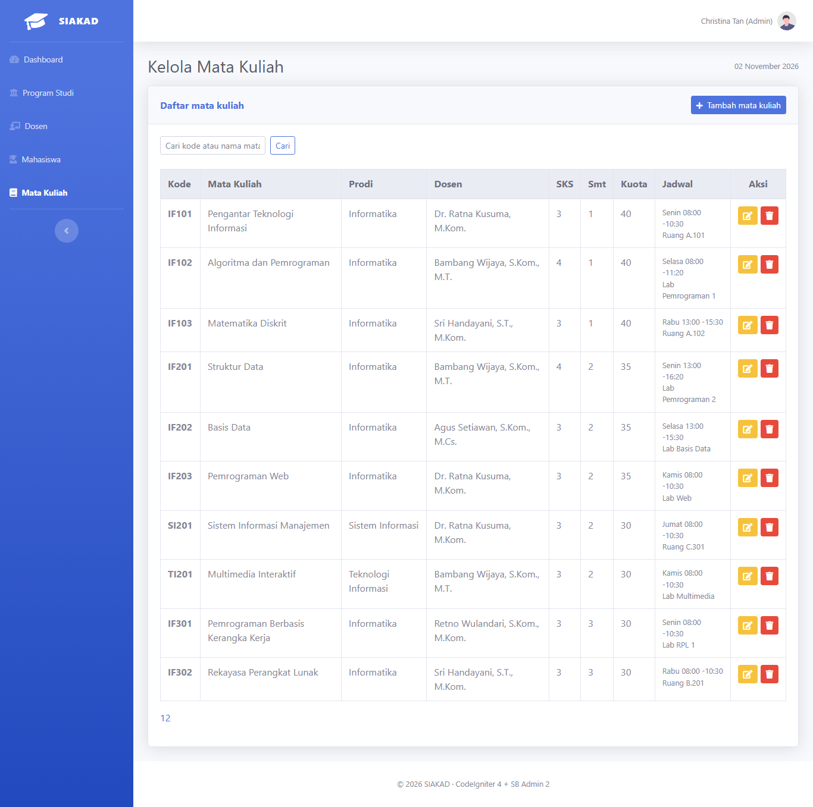

*Gambar 20. Daftar mata kuliah beserta dosen pengampu, SKS, dan jadwal*

#### Validasi KRS

Aturan KRS saya kumpulkan di satu tempat sebelum menyimpan apa pun: batas SKS, kuota kelas, dan larangan mengambil mata kuliah yang sama dua kali. Semua pelanggaran dikumpulkan jadi satu pesan agar mahasiswa tidak memperbaiki satu per satu.

```php
if ($krsModel->sudahDiambil((int) $mhs['id'], $matakuliahId, $tahunAjaran)) {
    $galat[] = 'Mata kuliah ' . $matkul['nama'] . ' sudah diambil pada tahun ajaran ini.';
    continue;
}

$peserta = $krsModel->jumlahPeserta($matakuliahId, $tahunAjaran);
if ($peserta >= (int) $matkul['kuota']) {
    $galat[] = 'Kuota mata kuliah ' . $matkul['nama'] . ' sudah penuh ('
        . $peserta . '/' . $matkul['kuota'] . ').';
    continue;
}

$sksBaru += (int) $matkul['sks'];
$akanDisimpan[] = $matakuliahId;
```

Batas SKS tidak ditulis sebagai angka di controller, tetapi diambil dari config agar mudah diubah dan dipakai bersama.

```php
class Akademik extends BaseConfig
{
    public int $maxSks = 24;

    public string $tahunAjaranAktif = '2026/2027 Ganjil';

    public array $skalaNilai = [
        ['min' => 85, 'huruf' => 'A', 'bobot' => 4.0],
        ['min' => 75, 'huruf' => 'AB', 'bobot' => 3.5],
        ['min' => 65, 'huruf' => 'B', 'bobot' => 3.0],
        ['min' => 60, 'huruf' => 'BC', 'bobot' => 2.5],
        ['min' => 55, 'huruf' => 'C', 'bobot' => 2.0],
        ['min' => 40, 'huruf' => 'D', 'bobot' => 1.0],
        ['min' => 0, 'huruf' => 'E', 'bobot' => 0.0],
    ];
}
```

Halaman KRS menampilkan mata kuliah yang sudah diambil dan yang masih bisa diambil. Mata kuliah yang sudah diambil atau kuotanya penuh diberi tanda, bukan checkbox.

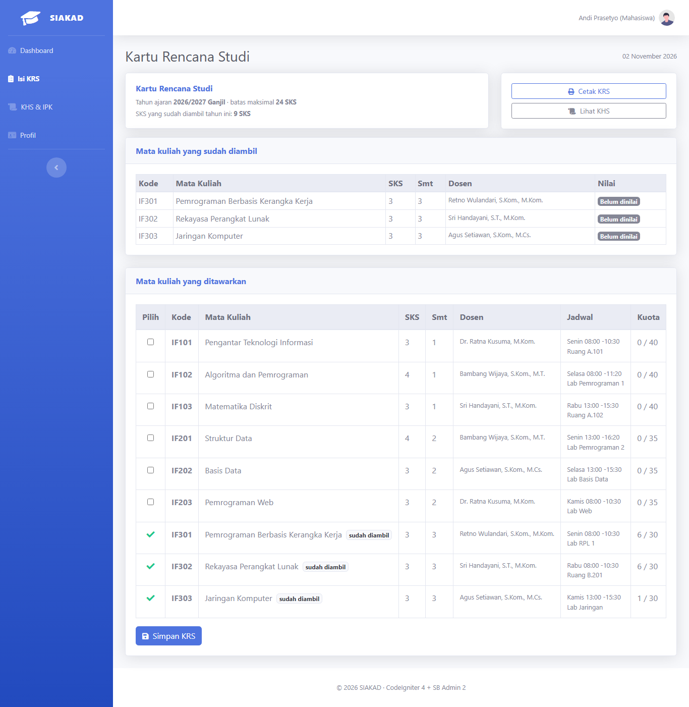

*Gambar 21. Halaman pengisian KRS mahasiswa*

Kalau total SKS melewati batas, seluruh pengajuan ditolak dan pesannya menyebut angka pastinya:

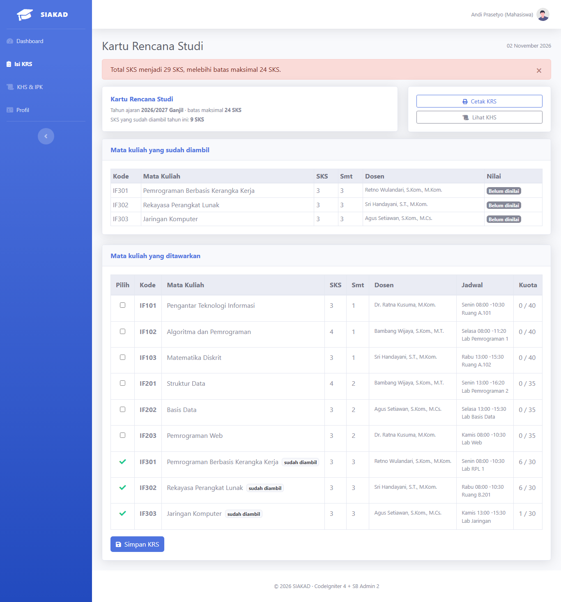

*Gambar 22. KRS ditolak karena total SKS melebihi batas 24 SKS*

#### Input nilai dan konversi otomatis

Dosen hanya bisa menilai kelasnya sendiri. Pemeriksaan kepemilikan dilakukan di setiap request, bukan sekadar menyembunyikan tautan, sehingga menebak URL kelas dosen lain tetap ditolak.

```php
if ((int) $matkul['dosen_id'] !== (int) $dosen['id']) {
    return $this->tolakAkses();
}
```

Nilai angka lalu dikonversi memakai skala yang sama dengan config, jadi huruf dan bobot tidak mungkin berbeda antar halaman.

```php
public function konversiNilai(int $angka): array
{
    $akademik = config('Akademik');

    foreach ($akademik->skalaNilai as $skala) {
        if ($angka >= $skala['min']) {
            return ['huruf' => $skala['huruf'], 'bobot' => (float) $skala['bobot']];
        }
    }

    return ['huruf' => 'E', 'bobot' => 0.0];
}
```

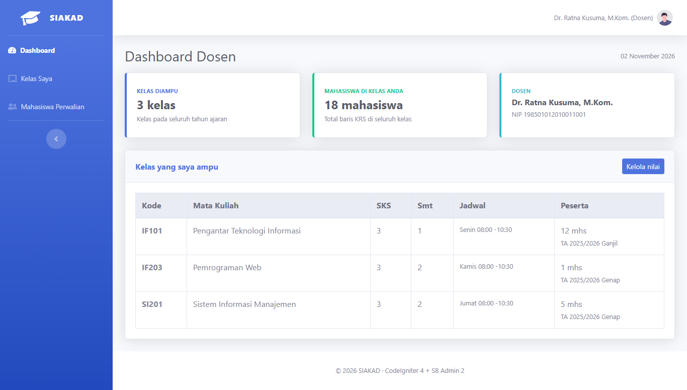

*Gambar 23. Dashboard dosen dengan jumlah kelas dan mahasiswa*

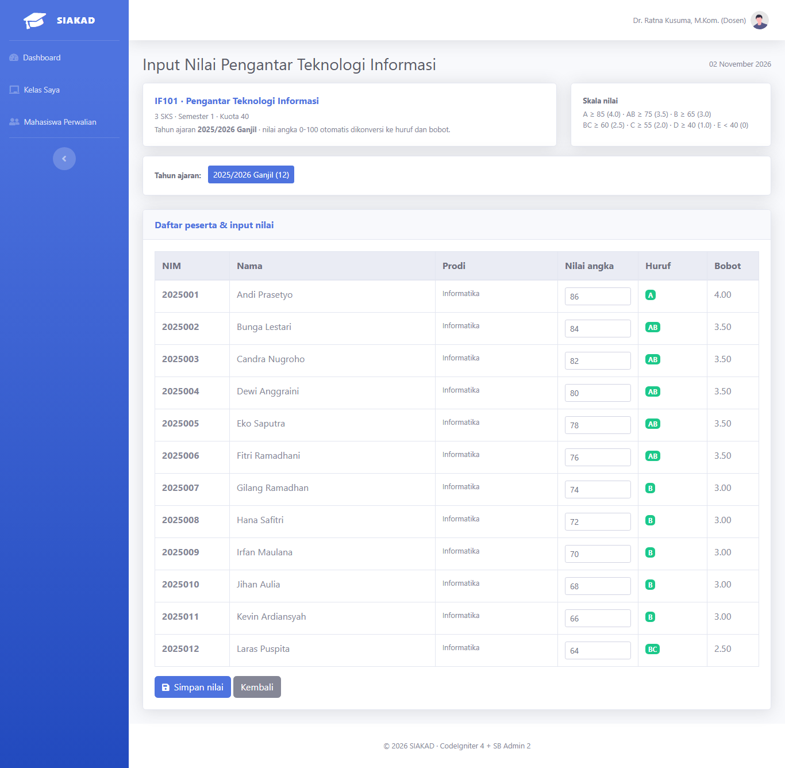

*Gambar 24. Daftar peserta kelas dan nilai huruf yang terisi otomatis*

#### KHS, IP, dan IPK

Perhitungan IP dilakukan per semester, lalu IPK menjumlahkan semuanya. Hanya mata kuliah yang sudah dinilai yang ikut dihitung, dan pembagian nol ditangani supaya tidak error saat mahasiswa belum punya nilai.

```php
public function ipk(int $mahasiswaId): array
{
    $totalSks  = 0;
    $totalMutu = 0.0;

    foreach ($this->rekapPerSemester($mahasiswaId) as $semester) {
        $totalSks += $semester['total_sks'];
        $totalMutu += $semester['total_mutu'];
    }

    return [
        'sks'  => $totalSks,
        'mutu' => $totalMutu,
        'ipk'  => $totalSks > 0 ? round($totalMutu / $totalSks, 2) : 0.0,
    ];
}
```

Sebagai pembanding manual untuk mahasiswa `2025001`: semester 1 menghasilkan mutu 38 dari 10 SKS (IP 3.80), semester 2 menghasilkan 38.5 dari 10 SKS (IP 3.85). Total 76.5 / 20 SKS = **3.825**, dibulatkan menjadi 3.83 — sama dengan yang tampil di aplikasi.

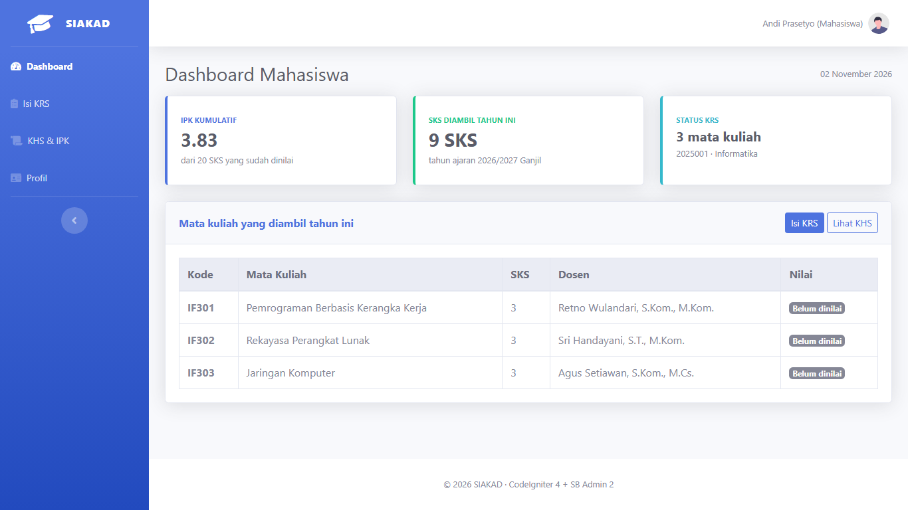

*Gambar 25. Dashboard mahasiswa dengan IPK dan SKS yang diambil*

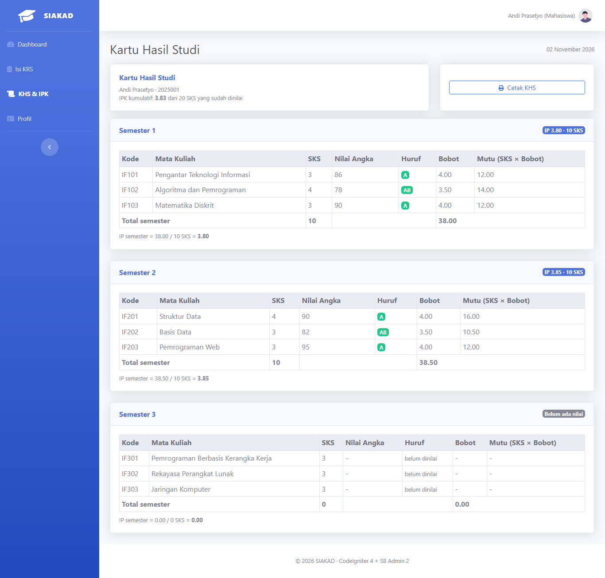

*Gambar 26. Kartu Hasil Studi dengan IP per semester dan IPK kumulatif*

Versi cetak memakai stylesheet `@media print` dan layout terpisah tanpa sidebar, sehingga hasil cetak bersih.

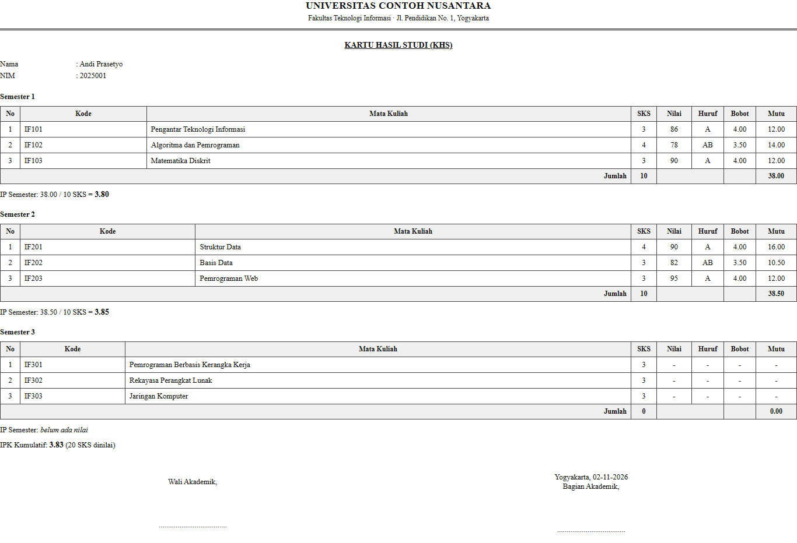

*Gambar 27. Tampilan cetak KHS*

### 1.3 Latihan 2b: ThriftIn

ThriftIn adalah toko barang preloved. Ciri yang membedakannya dari toko biasa: hampir semua barang stoknya satu, jadi stok harus ditahan begitu ada pesanan dan dikembalikan kalau pesanan batal atau kedaluwarsa.

| Bagian | Fitur |
|---|---|
| Publik | Beranda, katalog dengan pencarian/filter/urut harga/pagination, detail produk |
| Keranjang | Disimpan di session, harga dan stok selalu dibaca ulang dari database, ongkir flat Rp 20.000 (gratis mulai Rp 200.000) |
| Pembeli | Register, login, checkout, upload bukti transfer, batalkan pesanan, riwayat pesanan |
| Admin | Dashboard omzet & grafik, CRUD kategori, CRUD produk + upload foto, kelola pesanan & resi |

Halaman toko memakai Bootstrap 5, panel admin memakai SB Admin 2.

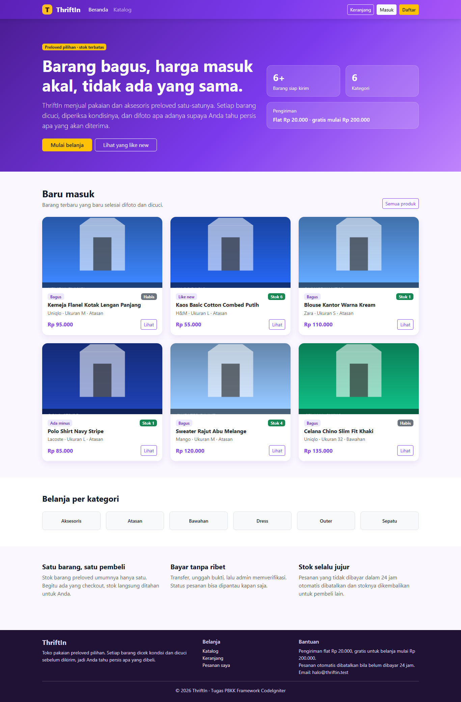

*Gambar 28. Beranda ThriftIn dengan banner dan produk terbaru*

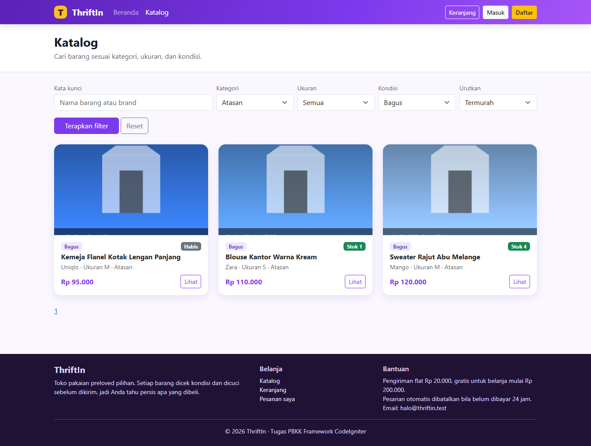

*Gambar 29. Katalog dengan filter kategori, ukuran, kondisi, dan urutan harga*

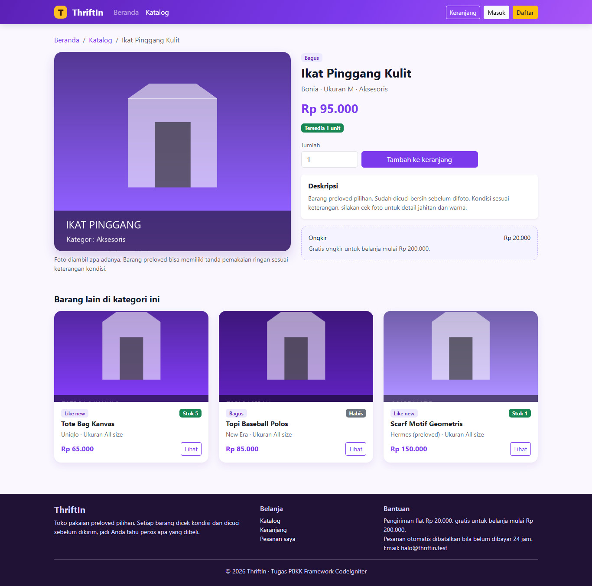

*Gambar 30. Detail produk dengan kondisi, ukuran, dan stok*

#### Keranjang: session hanya menyimpan ID dan jumlah

Keranjang disimpan sebagai `[produk_id => qty]`, tetapi harga tidak pernah ikut disimpan. Setiap kali halaman keranjang dibuka, harga dan stok dibaca ulang dari database, dan jumlah otomatis dipotong kalau stok menurun.

```php
$produkModel = new \App\Models\ProdukModel();
$daftar      = $produkModel->whereIn('id', array_keys($keranjang))->findAll();

// ...
$qty = min($qty, max(0, $stok));

if ($qty === 0) {
    continue;
}

$keranjangBaru[$id] = $qty;
$subtotal           = $qty * (int) $produk['harga'];
```

Dengan cara ini, kalau admin mengubah harga, pembeli langsung melihat harga baru; dan isi session tidak bisa dimanipulasi untuk mengubah harga.

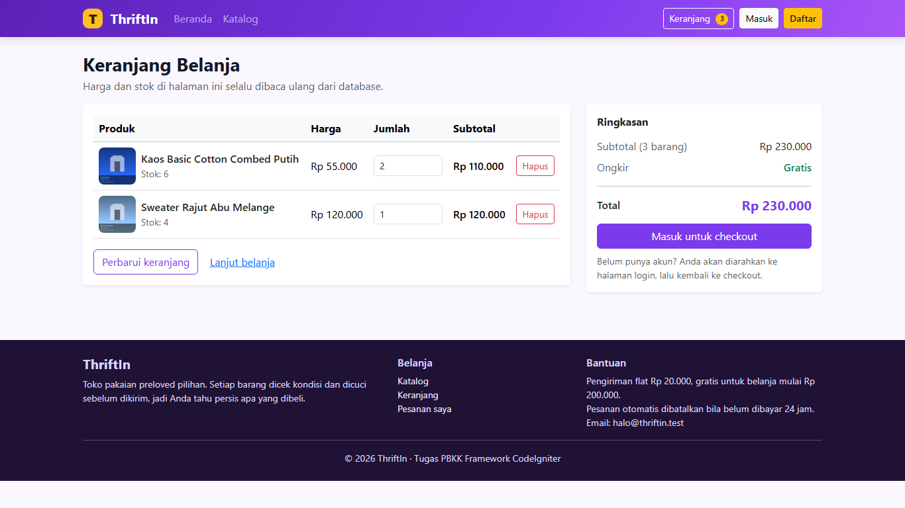

*Gambar 31. Keranjang belanja dengan harga terbaru dari database*

Kalau pembeli belum login dan menekan tombol checkout, URL tujuan disimpan di session sehingga setelah login ia kembali ke halaman checkout, bukan ke beranda.

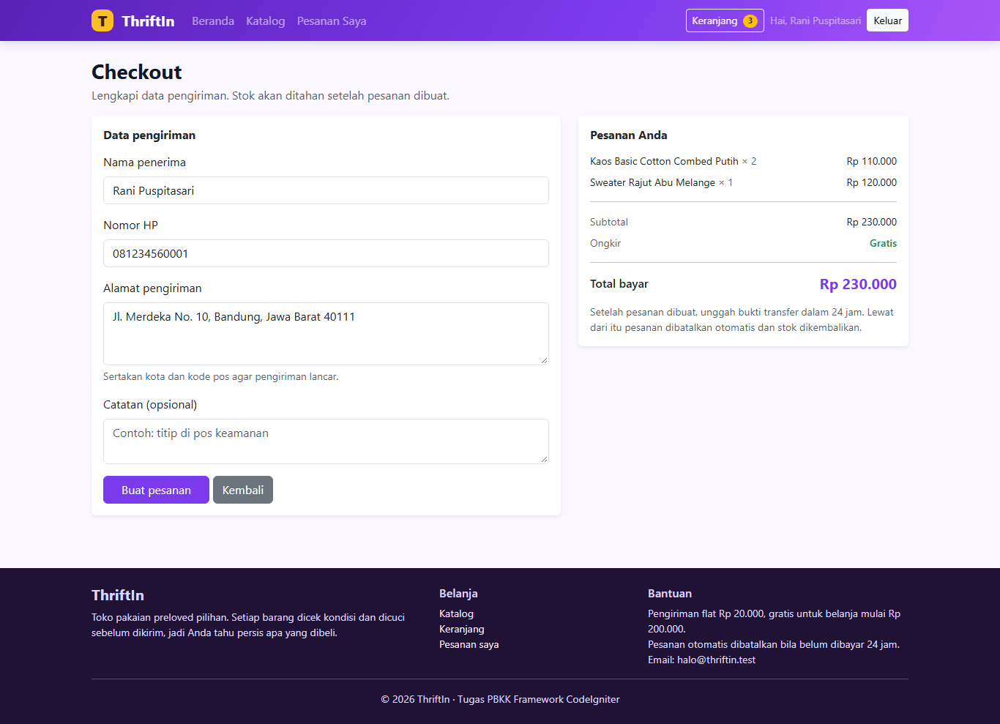

*Gambar 32. Halaman checkout dengan data pengiriman dan ringkasan pesanan*

#### Checkout dalam transaksi dan stok yang tidak boleh minus

Checkout adalah bagian paling rawan: dua pembeli bisa menekan tombol hampir bersamaan untuk barang yang stoknya satu. Karena itu pengurangan stok memakai query bersyarat, dan hasilnya diperiksa dari `affectedRows()`.

```php
$db->table('produk')
    ->set('stok', 'stok - ' . $qty, false)
    ->where('id', $produkId)
    ->where('stok >=', $qty)
    ->update();

if ($db->affectedRows() !== 1) {
    throw new \RuntimeException('Stok tidak mencukupi untuk ' . $item['nama'] . '.');
}
```

Seluruh proses berada di dalam `transStart()`/`transComplete()`, jadi kalau satu item gagal, pesanan dan pengurangan stok item sebelumnya dibatalkan semua.

Nomor invoice dibuat berurutan per hari, di dalam transaksi yang sama supaya tidak ada nomor kembar.

```php
public function buatInvoice(): string
{
    $prefix = 'TI-' . date('Ymd') . '-';

    $terakhir = $this->db->table('orders')
        ->select('invoice')
        ->like('invoice', $prefix, 'after')
        ->orderBy('invoice', 'DESC')
        ->limit(1)
        ->get()
        ->getRowArray();

    $urut = $terakhir === null
        ? 1
        : (int) substr((string) $terakhir['invoice'], strlen($prefix)) + 1;

    return $prefix . str_pad((string) $urut, 4, '0', STR_PAD_LEFT);
}
```

Item pesanan disimpan sebagai snapshot. Kalau nanti harga produk naik atau produknya dihapus, riwayat pesanan tetap menampilkan nama dan harga saat transaksi.

```php
$itemModel->insert([
    'order_id'    => $orderId,
    'produk_id'   => $produkId,
    'nama_produk' => $item['nama'],
    'harga'       => $item['harga'],
    'qty'         => $qty,
    'subtotal'    => $item['subtotal'],
]);
```

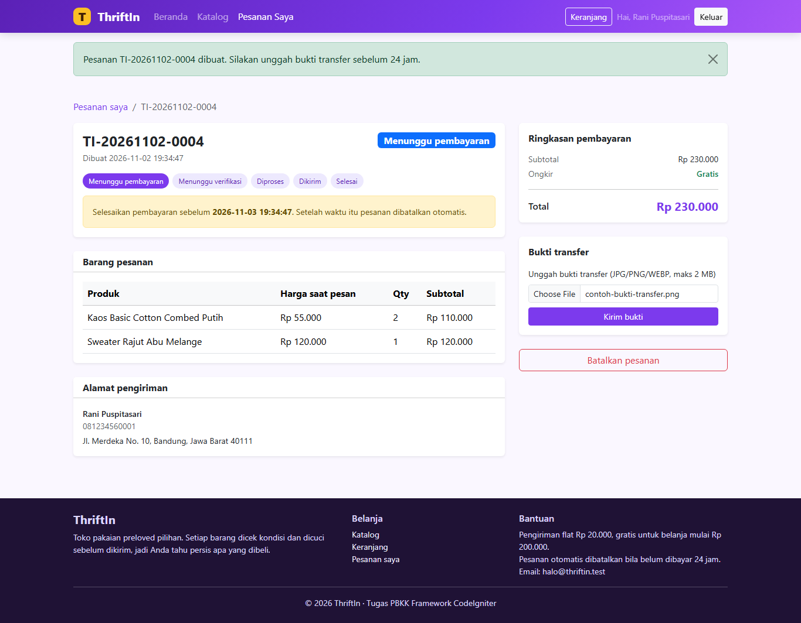

*Gambar 33. Detail pesanan dengan form unggah bukti transfer*

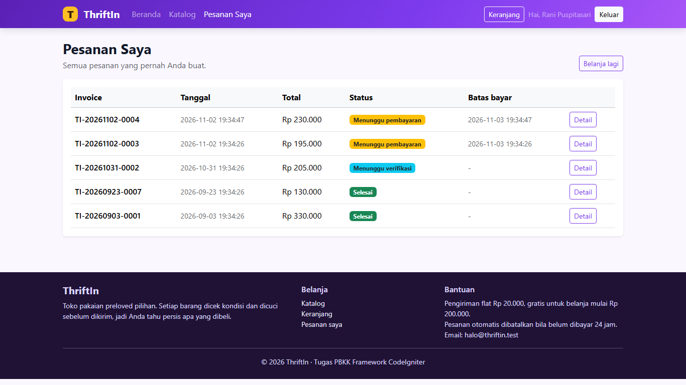

*Gambar 34. Riwayat pesanan pembeli beserta status dan batas pembayaran*

#### Alur status pesanan

Perpindahan status tidak bebas. Saya menyimpannya sebagai konstanta di model, dan setiap perubahan harus ada di daftar tujuan yang diizinkan.

```php
public const ALUR = [
    'menunggu_pembayaran' => ['menunggu_verifikasi', 'dibatalkan'],
    'menunggu_verifikasi' => ['diproses', 'menunggu_pembayaran', 'dibatalkan'],
    'diproses'            => ['dikirim', 'dibatalkan'],
    'dikirim'             => ['selesai'],
    'selesai'             => [],
    'dibatalkan'          => [],
];
```

Pembatalan bukan hanya mengubah status, tetapi juga mengembalikan stok produk yang sebelumnya ditahan.

```php
if (! $this->transisiDiizinkan($statusLama, $statusBaru)) {
    return [
        'ok'    => false,
        'pesan' => 'Perubahan status dari ' . $this->label($statusLama) . ' ke '
            . $this->label($statusBaru) . ' tidak diizinkan.',
    ];
}

$db = db_connect();
$db->transStart();

if ($statusBaru === 'dibatalkan') {
    $this->kembalikanStok($orderId);
}

$this->update($orderId, $data);
$db->transComplete();
```

Dashboard admin menampilkan omzet, jumlah pesanan per status, produk terjual, grafik omzet per bulan, dan daftar stok menipis.

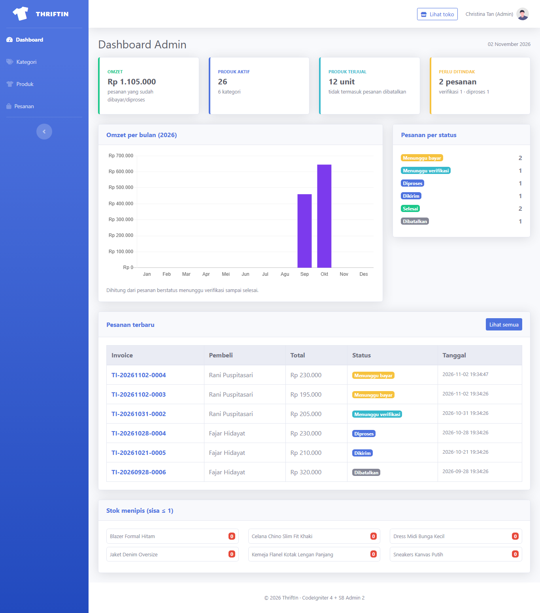

*Gambar 35. Dashboard admin ThriftIn dengan omzet, grafik, dan pesanan terbaru*

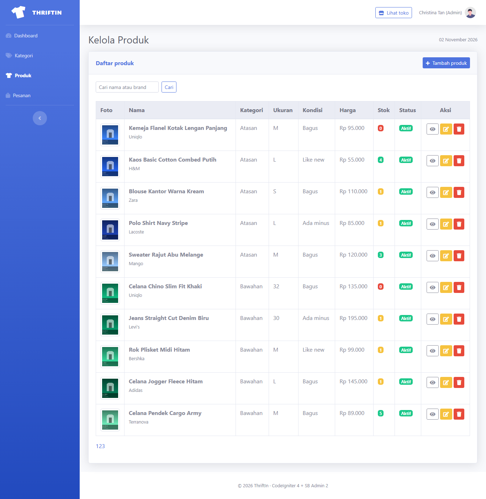

*Gambar 36. Daftar produk admin dengan foto, stok, dan status aktif*

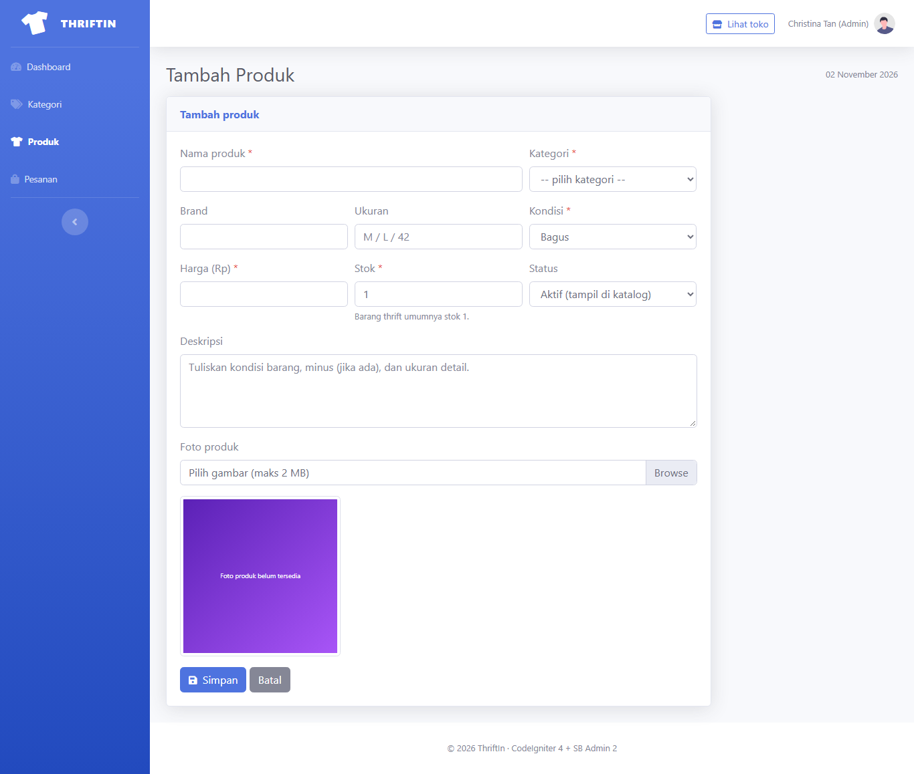

*Gambar 37. Form produk dengan pratinjau foto*

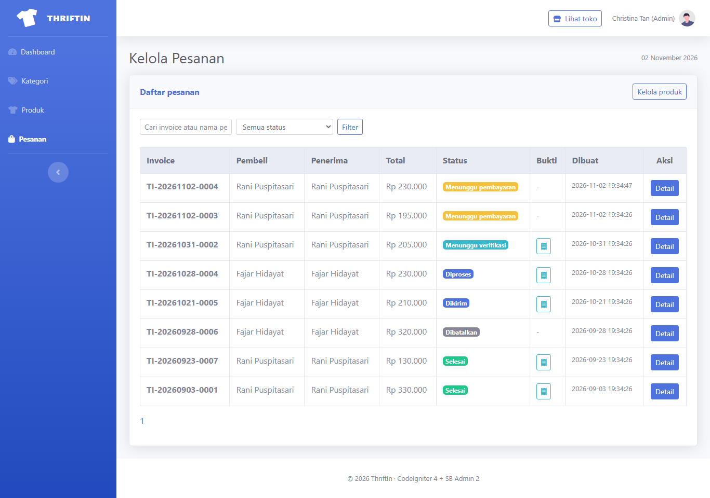

*Gambar 38. Halaman kelola pesanan dengan filter status*

Di halaman detail, pilihan status yang muncul hanya status yang diizinkan. Walaupun begitu, kalau request dikirim manual dengan status lain, model tetap menolaknya.

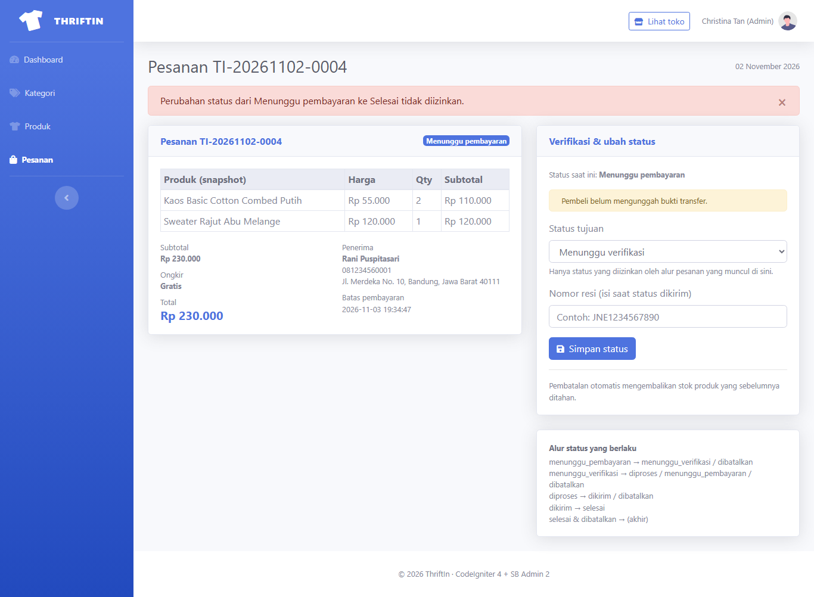

*Gambar 39. Perubahan status yang tidak sesuai alur ditolak*

#### Pesanan kedaluwarsa 24 jam

Pesanan yang belum dibayar lebih dari 24 jam dibatalkan otomatis lewat spark command. Saya memilih command, bukan cron, karena tugas ini hanya butuh demonstrasi yang bisa dijalankan manual.

```php
class ExpireOrder extends BaseCommand
{
    protected $group       = 'ThriftIn';
    protected $name        = 'order:expire';
    protected $description = 'Membatalkan pesanan menunggu pembayaran yang sudah kedaluwarsa (lewat 24 jam).';

    public function run(array $params)
    {
        $model = new OrderModel();
        $hasil = $model->batalkanKedaluwarsa();

        if ($hasil['jumlah'] === 0) {
            CLI::write('Tidak ada pesanan kedaluwarsa.', 'yellow');

            return EXIT_SUCCESS;
        }

        CLI::write($hasil['jumlah'] . ' pesanan dibatalkan dan stoknya dikembalikan:', 'green');

        foreach ($hasil['invoice'] as $invoice) {
            CLI::write('  - ' . $invoice);
        }

        return EXIT_SUCCESS;
    }
}
```

Tampilan katalog pada ponsel:

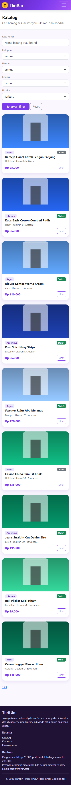

*Gambar 40. Katalog ThriftIn pada viewport mobile 390x844*

## 2. Langkah Instalasi CodeIgniter dan Konfigurasinya

Bagian ini saya susun dari catatan pengerjaan di `docs/log-pengerjaan.md`, jadi urutannya sama dengan yang benar-benar saya jalankan.

### 2.1 Persiapan lingkungan

Saya memakai Laragon, bukan XAMPP. Perbedaannya cukup terasa: Laragon sudah membawa PHP, MySQL, Composer, dan Node dalam satu folder sehingga tidak perlu mengatur `PATH` manual. Yang perlu dipastikan:

```bash
php -v          # minimal PHP 8.2
composer -V
mysql --version
```

Ekstensi PHP yang wajib aktif: `intl`, `mbstring`, `mysqlnd`, `mysqli`, `curl`, `json`, `fileinfo`, `gd`. Di mesin saya, `intl` dan `mysqli` ternyata masih dikomentari di `php.ini`:

```ini
;extension=intl
;extension=mysqli
```

Keduanya saya aktifkan, lalu saya cek ulang dengan `php -m`. Kalau memakai Laragon, ekstensi juga bisa dicentang lewat menu PHP → Extensions.

### 2.2 Instalasi CodeIgniter 4 via Composer

```bash
cd C:\Users\Tina\PBKK\week9
composer create-project codeigniter4/appstarter latihan1
composer create-project codeigniter4/appstarter latihan2a
composer create-project codeigniter4/appstarter latihan2b
```

Versi yang terpasang dicek dengan `php spark --version` dan hasilnya **CodeIgniter v4.7.6**. Saat pengerjaan, folder project saya beri nama `latihan1-kosku`, `latihan2a-siakad`, dan `latihan2b-thriftin`; di folder penyerahan ini namanya dipersingkat menjadi `latihan1`, `latihan2a`, dan `latihan2b` agar mudah dicari. Halaman welcome di dua project lain saya buka untuk memastikan instalasinya juga sehat:


*Gambar 41. Halaman welcome CodeIgniter pada project SIAKAD*

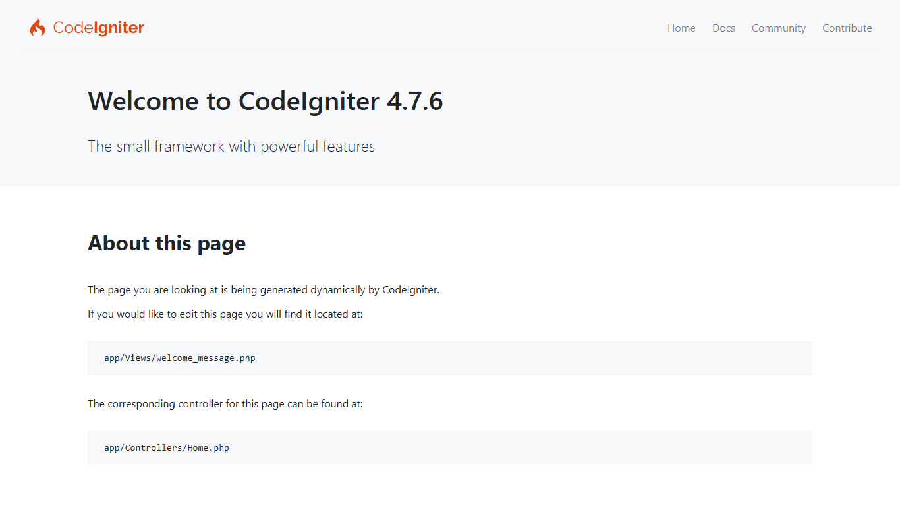

*Gambar 42. Halaman welcome CodeIgniter pada project ThriftIn*

### 2.3 Konfigurasi `.env`

Setiap project menyalin file `env` menjadi `.env` dan memakai database serta port sendiri, karena ketiganya dijalankan bersamaan.

| Project | Port | Database |
|---|---|---|
| latihan1 | 8081 | ci4_kosku |
| latihan2a | 8082 | ci4_siakad |
| latihan2b | 8083 | ci4_thriftin |

Isi `.env`:

```ini
CI_ENVIRONMENT = development

app.baseURL = 'http://localhost:8081/'
app.indexPage = ''
app.appTimezone = 'Asia/Jakarta'
app.defaultLocale = 'id'

database.default.hostname = localhost
database.default.database = ci4_kosku
database.default.username = root
database.default.password = ******
database.default.DBDriver = MySQLi
database.default.port = 3306
```

`app.indexPage` dikosongkan supaya `index.php` tidak muncul di URL. `.env` tidak ikut di-commit (ada di `.gitignore`), dan sebagai gantinya tiap project menyediakan `.env.example` dengan password kosong.

### 2.4 Membuat database, migration, dan seeder

```bash
mysql -u root -p -e "
CREATE DATABASE ci4_kosku    CHARACTER SET utf8mb4 COLLATE utf8mb4_unicode_ci;
CREATE DATABASE ci4_siakad   CHARACTER SET utf8mb4 COLLATE utf8mb4_unicode_ci;
CREATE DATABASE ci4_thriftin CHARACTER SET utf8mb4 COLLATE utf8mb4_unicode_ci;"
```

Lalu di masing-masing folder project:

```bash
php spark migrate
php spark db:seed DatabaseSeeder
```

Skema dibuat lewat migration dan data awal lewat seeder, bukan manual di phpMyAdmin, supaya orang lain bisa mengulang prosesnya persis sama.

### 2.5 Konfigurasi tambahan

- **Zona waktu dan locale**: `Asia/Jakarta` dan `id` (ditulis di `.env`, jadi menimpa `app/Config/App.php`).
- **CSRF**: filter `csrf` diaktifkan di `$globals['before']` pada `app/Config/Filters.php`, sehingga semua form POST wajib menyertakan `csrf_field()`.
- **Helper global**: `form`, `url`, `text` (ditambah `berkas` untuk upload dan `toko` untuk perhitungan keranjang) didaftarkan di `BaseController` supaya bisa dipakai di semua controller.
- **Alias filter**: `auth` dan `role` didaftarkan di `app/Config/Filters.php`.
- **Debug toolbar** dimatikan saat pengambilan screenshot agar tidak menutupi halaman; pesan error tetap muncul karena environment masih `development`.

```php
public array $aliases = [
    'csrf'          => CSRF::class,
    'toolbar'       => DebugToolbar::class,
    // ...
    'auth'          => \App\Filters\AuthFilter::class,
    'role'          => \App\Filters\RoleFilter::class,
];
```

### 2.6 Menjalankan aplikasi dan akun demo

```bash
cd C:\Users\Tina\PBKK\week9\latihan1 && php spark serve --port 8081
cd C:\Users\Tina\PBKK\week9\latihan2a && php spark serve --port 8082
cd C:\Users\Tina\PBKK\week9\latihan2b && php spark serve --port 8083
```

Saya memilih `php spark serve` dengan port berbeda, bukan virtual host Laragon, supaya ketiga aplikasi bisa hidup bersamaan tanpa mengubah file `hosts`.

| Aplikasi | Role | Username | Password |
|---|---|---|---|
| KosKu | admin | `admin` | `admin123` |
| KosKu | penghuni | `penghuni1` | `penghuni123` |
| SIAKAD | admin | `admin` | `admin123` |
| SIAKAD | dosen | `dosen1` | `dosen123` |
| SIAKAD | mahasiswa | `2025001` | `mhs123` |
| ThriftIn | admin | `admin` | `admin123` |
| ThriftIn | pembeli | `pembeli1` | `pembeli123` |

Selain akun di atas, SIAKAD juga punya akun `dosen2` sampai `dosen5` dengan password `dosen123`, dan mahasiswa `2025002` sampai `2025020` dengan password sama dengan NIM-nya. Perlu dibedakan: akun **hasil seeder** memakai pola itu, sedangkan akun yang **dibuat lewat panel admin** (mahasiswa/dosen baru) otomatis memakai username NIP/NIM dengan password awal sama dengan NIP/NIM.

Keluaran `php spark routes` untuk tiap project saya simpan sebagai lampiran di `docs/routes-latihan1.txt`, `docs/routes-latihan2a.txt`, dan `docs/routes-latihan2b.txt`, supaya daftar rute (beserta filter `auth` dan `role` yang menempel) bisa diperiksa tanpa menjalankan aplikasi.

Kalau ingin menjalankan ulang dari nol (misalnya di komputer lain), cukup lima perintah per project:

```bash
php spark migrate:refresh
php spark db:seed DatabaseSeeder
php spark serve --port 8081
```

Untuk ThriftIn, tambahkan satu perintah demo pembatalan otomatis:

```bash
php spark order:expire
```


## 3. Model Data

### 3.1 KosKu

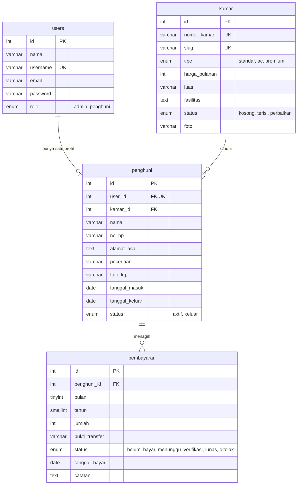

**users**

| Kolom | Tipe | Keterangan |
|---|---|---|
| id | INT UNSIGNED | PK, auto increment |
| nama | VARCHAR(100) | nama lengkap |
| username | VARCHAR(50) | unik, dipakai untuk login |
| email | VARCHAR(100) | nullable |
| password | VARCHAR(255) | hash `password_hash()` |
| role | ENUM | `admin` / `penghuni` |
| created_at, updated_at | DATETIME | otomatis dari model |

**kamar**

| Kolom | Tipe | Keterangan |
|---|---|---|
| id | INT UNSIGNED | PK |
| nomor_kamar | VARCHAR(20) | unik |
| slug | VARCHAR(100) | unik, dipakai di URL detail |
| tipe | ENUM | `standar` / `ac` / `premium` |
| harga_bulanan | INT UNSIGNED | rupiah per bulan |
| luas | VARCHAR(20) | nullable, mis. `3x4` |
| fasilitas | TEXT | nullable, dipisah koma |
| status | ENUM | `kosong` / `terisi` / `perbaikan` |
| foto | VARCHAR(255) | nullable, nama file di `public/uploads/kamar` |

**penghuni**

| Kolom | Tipe | Keterangan |
|---|---|---|
| id | INT UNSIGNED | PK |
| user_id | INT UNSIGNED | FK ke `users.id`, unik (relasi 1-1) |
| kamar_id | INT UNSIGNED | FK ke `kamar.id` |
| nama | VARCHAR(100) | nama penyewa |
| no_hp | VARCHAR(20) | nullable |
| alamat_asal | TEXT | nullable |
| pekerjaan | VARCHAR(100) | nullable |
| foto_ktp | VARCHAR(255) | nullable, disimpan di folder privat |
| tanggal_masuk | DATE | nullable |
| tanggal_keluar | DATE | nullable |
| status | ENUM | `aktif` / `keluar` |

**pembayaran**

| Kolom | Tipe | Keterangan |
|---|---|---|
| id | INT UNSIGNED | PK |
| penghuni_id | INT UNSIGNED | FK ke `penghuni.id` |
| bulan | TINYINT UNSIGNED | 1-12 |
| tahun | SMALLINT UNSIGNED | mis. 2026 |
| jumlah | INT UNSIGNED | nominal tagihan |
| bukti_transfer | VARCHAR(255) | nullable |
| status | ENUM | `belum_bayar`, `menunggu_verifikasi`, `lunas`, `ditolak` |
| tanggal_bayar | DATE | nullable |
| catatan | TEXT | nullable, alasan penolakan |

Relasi dan alasan desainnya:

- `users 1—1 penghuni`: kolom `user_id` dibuat unik supaya satu akun tidak bisa terhubung ke dua data penghuni.
- `kamar 1—N penghuni`: satu kamar bisa punya banyak riwayat penghuni, tetapi hanya satu yang berstatus `aktif`. Aturan ini dijaga di controller (`penghuniAktifPerKamar()`), karena MySQL tidak bisa membuat unique index bersyarat.
- `penghuni 1—N pembayaran`: setiap tagihan milik satu penghuni. Kombinasi unik `(penghuni_id, bulan, tahun)` mencegah tagihan dobel pada periode yang sama.

Potongan model yang menjaga aturan ini:

```php
class KamarModel extends Model
{
    protected $table         = 'kamar';
    protected $allowedFields = [
        'nomor_kamar', 'slug', 'tipe', 'harga_bulanan',
        'luas', 'fasilitas', 'status', 'foto',
    ];
    protected $useTimestamps = true;

    protected $validationRules = [
        'nomor_kamar'   => 'required|max_length[20]',
        'tipe'          => 'required|in_list[standar,ac,premium]',
        'harga_bulanan' => 'required|integer|greater_than[0]',
        'status'        => 'required|in_list[kosong,terisi,perbaikan]',
    ];
}
```

### 3.2 SIAKAD

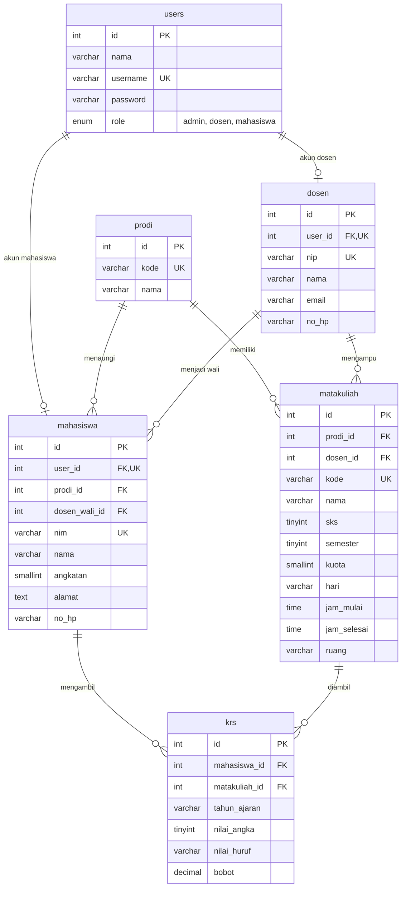

**users**: `id`, `nama`, `username` (unik), `password`, `role` (`admin`/`dosen`/`mahasiswa`), timestamps. Satu akun hanya boleh terhubung ke satu baris dosen atau satu baris mahasiswa, karena `dosen.user_id` dan `mahasiswa.user_id` dibuat unik.

**prodi**: `id`, `kode` (unik, mis. `IF`), `nama`, timestamps.

**dosen**: `id`, `user_id` (FK, unik), `nip` (unik), `nama`, `email`, `no_hp`, timestamps. NIP dipakai sebagai username akun agar admin cukup mencatat satu identitas.

**mahasiswa**: `id`, `user_id` (FK, unik), `prodi_id` (FK), `dosen_wali_id` (FK ke `dosen`, nullable), `nim` (unik), `nama`, `angkatan`, `alamat`, `no_hp`, timestamps. Dosen wali dibuat nullable karena mahasiswa bisa masuk sebelum walinya ditetapkan.

**matakuliah**: `id`, `prodi_id` (FK), `dosen_id` (FK pengampu), `kode` (unik), `nama`, `sks`, `semester`, `kuota`, `hari`, `jam_mulai`, `jam_selesai`, `ruang`, timestamps. `kuota` disimpan di sini karena satu kelas punya batas peserta sendiri.

**krs**

| Kolom | Tipe | Keterangan |
|---|---|---|
| id | INT UNSIGNED | PK |
| mahasiswa_id | INT UNSIGNED | FK ke `mahasiswa.id` |
| matakuliah_id | INT UNSIGNED | FK ke `matakuliah.id` |
| tahun_ajaran | VARCHAR(30) | mis. `2026/2027 Ganjil` |
| nilai_angka | TINYINT UNSIGNED | nullable, 0-100 |
| nilai_huruf | VARCHAR(3) | nullable, hasil konversi |
| bobot | DECIMAL(3,2) | nullable, 0.00-4.00 |

Alasan desain:

- Unik gabungan `(mahasiswa_id, matakuliah_id, tahun_ajaran)` mencegah satu mata kuliah diambil dua kali pada tahun ajaran yang sama, tanpa melarang pengambilan ulang di tahun berbeda.
- `nilai_angka`, `nilai_huruf`, dan `bobot` disimpan berbarengan. Huruf dan bobot sebenarnya bisa dihitung ulang, tetapi menyimpannya membuat KHS dan IPK tidak berubah kalau suatu saat skala nilai diubah. Untuk data baru, skala tetap dipakai lewat satu config.
- Relasi `dosen 1—N mahasiswa` (sebagai wali) dan `mahasiswa 1—N krs` memungkinkan halaman perwalian menghitung IPK tiap mahasiswa tanpa query tambahan yang rumit.

```php
class KrsModel extends Model
{
    protected $table         = 'krs';
    protected $allowedFields = [
        'mahasiswa_id', 'matakuliah_id', 'tahun_ajaran',
        'nilai_angka', 'nilai_huruf', 'bobot',
    ];
    protected $useTimestamps = true;

    protected $validationRules = [
        'mahasiswa_id'  => 'required|integer',
        'matakuliah_id' => 'required|integer',
        'tahun_ajaran'  => 'required|max_length[30]',
    ];
}
```

### 3.3 ThriftIn

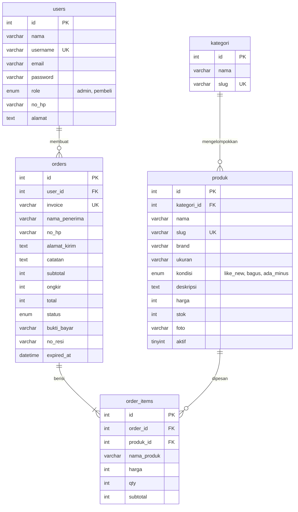

**users**: `id`, `nama`, `username` (unik), `email`, `password`, `role` (`admin`/`pembeli`), `no_hp`, `alamat`, timestamps. Alamat disimpan di akun supaya form checkout bisa terisi otomatis.

**kategori**: `id`, `nama`, `slug` (unik), timestamps.

**produk**

| Kolom | Tipe | Keterangan |
|---|---|---|
| id | INT UNSIGNED | PK |
| kategori_id | INT UNSIGNED | FK ke `kategori.id` |
| nama | VARCHAR(120) | nama barang |
| slug | VARCHAR(150) | unik, dipakai di URL |
| brand | VARCHAR(60) | nullable |
| ukuran | VARCHAR(20) | nullable, mis. `M`, `42` |
| kondisi | ENUM | `like_new` / `bagus` / `ada_minus` |
| deskripsi | TEXT | nullable |
| harga | INT UNSIGNED | rupiah |
| stok | INT UNSIGNED | default 1, umumnya 1 untuk barang thrift |
| foto | VARCHAR(255) | nama file di `public/uploads/produk` |
| aktif | TINYINT(1) | 0/1, produk lama dinonaktifkan bukan dihapus |

**orders**

| Kolom | Tipe | Keterangan |
|---|---|---|
| id | INT UNSIGNED | PK |
| user_id | INT UNSIGNED | FK ke `users.id` |
| invoice | VARCHAR(30) | unik, format `TI-YYYYMMDD-0001` |
| nama_penerima | VARCHAR(100) | |
| no_hp | VARCHAR(20) | |
| alamat_kirim | TEXT | |
| catatan | TEXT | nullable |
| subtotal | INT UNSIGNED | total harga barang |
| ongkir | INT UNSIGNED | 0 atau 20.000 |
| total | INT UNSIGNED | subtotal + ongkir |
| status | ENUM | 6 status sesuai alur |
| bukti_bayar | VARCHAR(255) | nullable, disimpan privat |
| no_resi | VARCHAR(100) | nullable |
| expired_at | DATETIME | batas bayar 24 jam |

**order_items**

| Kolom | Tipe | Keterangan |
|---|---|---|
| id | INT UNSIGNED | PK |
| order_id | INT UNSIGNED | FK ke `orders.id` |
| produk_id | INT UNSIGNED | FK ke `produk.id`, **nullable** (ON DELETE SET NULL) |
| nama_produk | VARCHAR(120) | snapshot nama saat transaksi |
| harga | INT UNSIGNED | snapshot harga saat transaksi |
| qty | INT UNSIGNED | jumlah |
| subtotal | INT UNSIGNED | harga × qty |

Alasan desain:

- **Snapshot di `order_items`.** Harga dan nama produk disalin saat checkout. Kalau produk dihapus, `produk_id` menjadi NULL tetapi riwayat pesanan tetap bisa dibaca, dan omzet lama tidak berubah karena harga produk berubah.
- **`expired_at` disimpan per pesanan** (bukan dihitung saat query), karena batas bayar harus tetap sama walaupun waktu server bergeser atau pesanan diubah statusnya.
- **Stok ditahan saat checkout, bukan saat pembayaran.** Barang thrift hanya satu, jadi menunggu pembayaran berarti barang bisa direbut orang lain. Konsekuensinya pesanan yang tidak dibayar harus dibatalkan otomatis dan stoknya dikembalikan.

```php
class OrderModel extends Model
{
    protected $table         = 'orders';
    protected $allowedFields = [
        'user_id', 'invoice', 'nama_penerima', 'no_hp', 'alamat_kirim', 'catatan',
        'subtotal', 'ongkir', 'total', 'status', 'bukti_bayar', 'no_resi', 'expired_at',
    ];
    protected $useTimestamps = true;

    public const ALUR = [
        'menunggu_pembayaran' => ['menunggu_verifikasi', 'dibatalkan'],
        'menunggu_verifikasi' => ['diproses', 'menunggu_pembayaran', 'dibatalkan'],
        'diproses'            => ['dikirim', 'dibatalkan'],
        'dikirim'             => ['selesai'],
        'selesai'             => [],
        'dibatalkan'          => [],
    ];
}
```